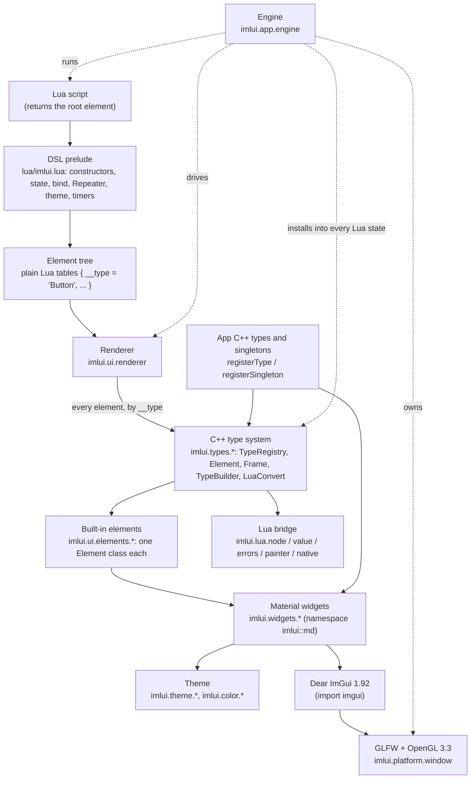

# Architecture

## Layers

| Layer | Responsibility |
|---|---|
| **Lua script** | Builds the element tree and returns the root. It owns all state and all decisions, including theme, window title and size. |
| **DSL prelude** (`lua/imlui.lua`) | Turns tables into elements (`Button {...}` tags the table with `__type`), and provides observable state, bindings, dynamic children, theme helpers, timers, the snackbar and logging. It also sets up the script environment, the `require` searcher for components and `ui.resource`. |
| **Element tree** | Ordinary Lua tables. Props are fields, children are the array part, and signals are `on*` functions. A table's identity (its pointer) is its ImGui ID, so elements keep per-widget state such as animations and focus across frames. |
| **Renderer** | Walks the tree on every rendered frame (immediate mode). For each element it applies the common props (`visible`, `enabled`, `tooltip`, the ID scope and the layout group) and hands the element to the type registry by its `__type` (through `Renderer::Types`, which `TypeRegistry` implements). An unregistered name reports "unknown element type". |
| **C++ type system** | `imlui.types.*`. C++ classes registered with `registerType<T>()` (elements, one instance per element table) and `registerSingleton()` (Lua globals), with properties, signals and methods declared through `TypeBuilder<T>`. To render an element, the registry syncs the declared properties from the element table into its instance and calls `Element::render(Frame&)`. Ticking elements (`Element::setTicking`) also get `tick(now)` at the start of every frame, rendered or not. See [Registering C++ types](extending.md). |
| **Built-in elements** | One `Element` class per module in `imlui.ui.elements.*` (`Button`, `Column`, `TabBar`, ...), registered by `registerBuiltinTypes()` exactly like an app's types. They call Material widgets, write two-way props back (`notify`) and emit signals. See [Elements](elements.md). |
| **Material widgets** | Material 3 controls drawn with ImGui primitives (`InvisibleButton` plus the draw list), using the current `imlui::theme()`. |
| **Resources** | `imlui.resources`. Every file the engine and the scripts load (Lua, fonts, data) is a resource named `prefix:/path` and served by stacked mounts. See [Resources](#resources). |
| **ImGui / platform** | Dear ImGui with the GLFW and OpenGL 3 backends, behind the `imgui` and `imlui.platform.window` wrapper modules. |

## Frame loop

`Engine::run()` does the following:

1. Creates the window **hidden**, sets the content scale from the monitor, logs the mounts, loads Roboto and
   Material Icons from `imlui:/fonts/`, applies the default theme, and loads the entry script.
2. Applies the root element's `title` and `width`/`height` (dp, multiplied by the content scale) to the native
   window, centers it and shows it.
3. Each loop iteration:
   - Every 400 ms, compares the modification times of the watched resources (hot reload). A change, or a `reload()` call, triggers
     `reloadNow()`.
   - Computes how long it may sleep: until the next **requested frame** (see below) or the next file check,
     whichever comes first. With nothing pending, that's the 400 ms hot-reload interval (or forever without hot
     reload). While minimized it sleeps at least 100 ms.
   - `window.waitEvents(timeout)` (`glfwWaitEventsTimeout`). Input or window events start a **settle period** of
     0.3 s, during which every iteration renders, so transitions and hover layers finish.
   - Runs the functions other threads queued with `Engine::post()`. They may `notify()` and so request a frame.
   - `renderFrame()`, but only if a frame is due. Otherwise the loop goes back to sleep without rendering.

### On-demand rendering

`imlui.ui.frame_request` keeps the pending frame requests: `requestFrame()` (as soon as possible),
`requestFrameAfter(seconds)` and `requestFramesFor(seconds)` (continuously, the settle period).
`secondsUntilFrame()` tells the loop when the next frame is due. At the start of a frame,
`beginFrameRequests()` drops the requests that frame serves, so anything that still needs frames asks again while
it renders. Requests that come in while the loop sleeps wake it through `glfwPostEmptyEvent()`.

Who requests frames:

| Source | Request |
|---|---|
| Input and window events (mouse, keys, focus, resize, DPI change) | the 0.3 s settle period |
| `md::animate` / `md::stateLayer` (every Material transition) | a frame while the value is still moving |
| Indeterminate `ProgressBar`, `CircularProgress`, `BusyIndicator` | every frame |
| `Canvas { animated = true }` | every frame |
| `Timer` elements | a frame when the interval is due |
| `ScriptObject::notify` / `ScriptObject::emit` (C++ types), `Engine::post` | a frame (waking the loop if it sleeps) |
| Lua timers: `ui.__tick` returns the seconds until the next `setTimeout`/`setInterval` | a frame then |
| `Snackbar` | every frame while it slides in or fades out, and a frame when the fade starts |
| Tooltips | a frame every 100 ms while an item is hovered but the tooltip delay hasn't passed |
| An active text field | a frame every 100 ms for the caret blink |
| A held mouse button | frames at 30 Hz (repeat buttons, drags that pause) |
| `ui.requestFrame(ms?)`, `ui.setZoom`, `native.injectMouse` | a frame (or the settle period) |
| A reload | the settle period |

`md::animate` caps the frame time it advances by at 1/30 s, so a transition that starts on the first frame after
a long sleep doesn't jump to its end.

### Scaling

`imlui.theme.dpi` holds the monitor **content scale** and the user **zoom**. `dpiScale()` is their product, and
`dp(v)` converts with it. The window reports content scale changes (`glfwSetWindowContentScaleCallback`), and
`ui.setZoom` and the zoom shortcuts schedule a zoom change. At the start of the next frame, `syncScale()` applies
the zoom and, if the effective scale changed, calls `reapplyTheme()`: the style is rebuilt from an unscaled
`ImGuiStyle`, then `ScaleAllSizes(dpiScale())` and `FontScaleDpi = dpiScale()` are applied, as for any new
theme. With `GLFW_SCALE_TO_MONITOR`, Windows resizes the native window itself when it moves to another monitor.

### Rendering a frame

`renderFrame()` renders one complete frame:

1. `beginFrameRequests()`, then **`syncScale()`**, which applies a pending zoom and the pending theme. `theme{}`
   and `setTheme` only *schedule* a theme. It's applied here, between frames, so a click handler can change the
   theme in the middle of a frame without breaking that frame's ImGui style stack. If only the scale changed, the
   current theme is re-applied.
2. `window.beginFrame()`, which starts a new ImGui frame. Then the zoom shortcuts are handled.
3. `ui.__tick(now)`: runs due `setTimeout`/`setInterval` timers, then ticks the C++ ticking elements (`Timer`;
   `require("imlui.types").tick(now)`, synced first, rendered or not), then the `onFrame` callbacks, and returns
   the seconds until the next timer.
4. Renders the root element.
5. Renders **overlays**: the children of `ui.__overlays`. Today that's the app-wide `Snackbar` element driven by
   `snackbar()`. Overlays draw above everything else.
6. Draws the **error overlay** if any script errors were recorded (see below).
7. `window.endFrame()`: clears to the current `WindowBg` color, renders the ImGui draw data and swaps buffers.
8. Copies `Renderer::windowTitle()` to the native window: the root `ApplicationWindow`'s `title` prop if it has
   one, else the last `ui.setTitle()` (the `setTitle` hook stores it in the renderer), else `"imlui"`. The native
   title is only updated when it changes.

**Live resize.** On Windows, the OS runs a modal loop while the user drags the window border, so
`glfwWaitEventsTimeout()` doesn't return. The engine registers `renderFrame` as the window's **refresh callback**, and
GLFW calls it from its refresh and framebuffer-size callbacks. The UI then lays itself out again during the drag.

**Error overlay.** All calls into Lua go through `luaui::safeCall`, which runs `pcall` with a traceback handler.
Errors are logged with the source tag `lua`, deduplicated, and capped at the last 32. While any are recorded, a
panel with the `errorContainer` color sits at the bottom center of the window, with **Dismiss** (clears the list)
and **Reload** buttons. An error in a binding or handler only affects that value or call, and the rest of the UI
keeps rendering.

## Property resolution

`luaui::Node` wraps an element table on the Lua stack. Every prop read (`n.string("text")`, `n.number("value")`,
`n.color("color")`, ...) **resolves** the raw field:

| Raw value | Read | Write-back (`Node::set`, when a widget changes it) |
|---|---|---|
| plain value, `text = "Hi"` | the value | stored on the element (`self.text = ...`) |
| function, `text = function(self) ... end` | called as `fn(self)` on **every read**, every frame (a *binding*) | **ignored**: the binding owns the value, so the widget snaps back to what the function returns |
| `bind(t, "k")` | `t.k` | `t.k = v` |
| `bind(getter, setter)` | `getter()` | `setter(v)` |

Because bindings are evaluated every frame, a UI that reads a `state{}` (or any table) inside a function always
shows current data. No dependency tracking is needed. `watch()` is only for side effects. "Every frame" means
every *rendered* frame: state changed by input handlers or timers is shown because those render a frame anyway.
Only a binding whose value changes by itself (for example from `time()`) needs `requestFrame()`.

Type coercion: numbers read where strings are expected are converted. Colors accept a role name, `role/alpha`,
hex, or `{r, g, b, a}` (see [Theming](theming.md#color-specs)). `Node::text()` returns the `text` prop, or the
first positional string: `Button { "OK" }` is the same as `Button { text = "OK" }`.

## Signals

Handlers are `on*` fields called as `handler(self, ...args)` through `safeCall`. Return values are ignored, and
errors go to the error overlay. Which signals exist and what arguments they get is listed per element in
[Elements](elements.md). A widget that changes a two-way prop writes the value first and then emits the signal,
so the handler already sees the new state.

## Children and inline containers

`Renderer::forEachChild` gets an element's children from one of two places:

- the array part of the table, or
- the result of `self.__children(self)` if that function exists. The prelude sets it for `Repeater`, `ListView`,
  `If`, `Loader` and `Responsive`.

Children whose table has `__inline = true` (`Repeater`, `If`, `Loader`, `Responsive`) are **spliced into the parent**: their
own children are laid out as direct children of the parent. That's why a `Repeater` inside a `Row` flows
horizontally. `visible = false` on an inline container hides all of its children. `ListView` isn't inline. It's
a scrolling `ScrollView` whose children come from `model`/`delegate`.

Layout notes:

- Each **visual** element is wrapped in an ImGui group, so it counts as exactly one layout item (a label plus a
  field behaves as one item in a `Row`).
- **Non-visual** elements (`ApplicationWindow`, `Window`, `Dialog`, `ModalNavigationDrawer`, `Snackbar`, `Timer`,
  `ImGuiDemo`, any registered with `visual = false`, and typed elements declared `nonVisual()`) take no layout
  space or spacing.
- Immediate-mode layout uses *last frame's* sizes for `Row` alignment, `justify`, fill spacers, `Column { align }`
  and `TopAppBar` actions. A layout settles within one frame.

## Hot reload

`Engine::reloadNow()`:

1. Clears recorded errors and resets the theme to `Theme{}` (seed `#6750A4`, dark).
2. Creates a new `lua_State`, opens the standard libraries, registers `imlui.native` (a `package.preload`
   entry) and the Canvas painter metatable, and installs the registered C++ types and singletons
   (`TypeRegistry::install`: the `imlui.types` library the DSL constructors use, methods tables, singleton
   globals).
3. Registers the resource loader (`luaui::registerResources`): the `imlui.resource` library and a
   `package.searchers` entry that finds modules in `imlui:/`. `package.path` keeps Lua's default, for plain Lua
   libraries; imlui's own files never go through it.
4. Runs a boot chunk: `require("imlui")` (`imlui:/imlui.lua`), `ui.__load(entry)` (`app:/main.lua`, run in
   `ui.env`), and returns the root, `ui.__tick` and `ui.__overlays`.
5. On failure (syntax error, runtime error, or a non-table return), it closes the new state, points the
   singletons back at the old one, restores the previous theme and keeps the old UI. On success, it replaces the
   old state and applies the window title and size (size only if it changed since the last load). Closing a
   state destroys the C++ instances of its elements and detaches the singletons from it.

The watcher polls `Resources::modified` for every `.lua` file in the mounted prefixes (`Resources::listRecursive`)
and for every resource a Lua state read or loaded. Only directory mounts report times; files in immutable mounts
(embedded data, `.pak` archives) never change while the app runs. With the same check, `ImageCache::refresh` drops
the images whose file changed; they're decoded again at their next use, without a reload.

## Resources

`Resources` (module `imlui.resources`) maps names to files. A name is `prefix:/path`: the prefix is a namespace
(`app` for the application, `imlui` for the library, others for libraries and plugins) and the path is
`/`-separated. Names are normalized (`app:/a/./b//c.lua` is `app:/a/b/c.lua`), and a `..` that would leave the
prefix's root, a backslash, a `:` in the path or a malformed prefix makes a name invalid. Prefixes are lowercase and
at least two characters long, so OS paths such as `C:/x` or `/etc/x` are never names (`imlui.resources.name`).

Each prefix has a stack of **mounts** (`Mount`), each at a mount point: the prefix root (`app:/`) or a folder in it
(`imlui:/fonts/`). A name is served by the newest mount that has it, so a later mount overrides single files of an
earlier one. `read` returns a span that stays valid as long as the mount lives; `exists`, `list`, `listRecursive`,
`modified` and `origin` complete the API.

| Mount | Notes |
|---|---|
| `DirectoryMount` | A folder on disk. Reads are cached per file while its time and size are unchanged; every buffer it ever read stays alive until the mount is destroyed, so spans (and the font atlas) can point into them. Reports modification times. |

`defaultConfig` mounts `imlui:/` on `<root>/lua`, `imlui:/fonts/` on `fonts/` next to the executable, and `app:/`
on the entry script's folder. The fonts are added to the ImGui atlas without a copy
(`FontDataOwnedByAtlas = false`), pointing into the bytes the mount keeps, so the `Resources` in `EngineConfig`
must outlive the atlas. The Engine keeps it for its whole lifetime, and the atlas dies with the window in `run()`.

Lua sees resources in two ways (`imlui.lua.resources`):

- Module search. `require("imlui")` and `require("a.b")` look in `imlui:/` (`a/b.lua`, then `a/b/init.lua`) through
  a `package.searchers` entry. `lua/imlui.lua` puts its own searcher in front of it, for components next to the
  script (`ui.__dir`), loaded in `ui.env`. Chunks are named `@app:/main.lua`, so errors and tracebacks read
  `app:/main.lua:12: ...`.
- `ui.resource.read`, `exists` and `url`. A relative name resolves against the folder of the calling script, found
  from the caller's chunk name.

### Images

`Image` elements draw from the `ImageCache` (module `imlui.image.image_cache`) that the Engine owns and hands to the
`Renderer` (`Frame::images()`). The `Image` constructor in `lua/imlui.lua` stores the creating script's name as
`__base`, and the element resolves `source` against it at every render. The cache decodes a name once with
stb_image (PNG and JPEG) and keeps the pixels as an `ImTextureData` registered with
`ImGui::RegisterUserTexture`: ImGui 1.92's texture list, so the OpenGL backend creates the GL texture before the
first frame that draws it (status `WantCreate`) and no GL call is made outside the backend. A failure (missing
file, not an image) is cached too and reported once. `refresh()` drops changed images: a texture the backend has
uploaded is marked `WantDestroyNextFrame`, the backend destroys it after the next frame and `collect()` (after each
frame) deletes it; one that was never uploaded is deleted at once. At shutdown the backend destroys the remaining
textures with the window, and the cache deletes the data after the ImGui context is gone. `smooth = false` uses
the backend's `DrawCallback_SetSamplerNearest`/`Linear` draw callbacks.

## Module map (target layout)

All project code is C++20 modules in `src/`. Each module exports one class or one family of functions, and the
implementation goes after `module :private;`. See [Development](development.md#module-conventions).

### Third-party wrappers (`src/wrap/`)

| Module | Purpose |
|---|---|
| `lua` | Lua 5.4 C API, with its macros turned into real functions (including full userdata, user values, `rawgetp`/`rawsetp` and `raise`); `lua::Type` enum, `lua::ok`, `registryIndex`, ... |
| `lua.stack_guard` | `lua::StackGuard`: restores the stack top on scope exit |
| `imgui` | Re-exports the ImGui API subset that imlui uses (types, flags, `ImGui::` functions, the user-texture calls `RegisterUserTexture`/`UnregisterUserTexture`); macros become `constexpr` functions |
| `stb_image` | stb_image (PNG and JPEG only, from memory) in namespace `stbi`; the implementation is compiled in `external/imlui_stb_image.c` |
| `imlui.log` | spdlog behind a `std::format` API: `imlui::log::info(...)`, `write(level, msg, source)`, `addFileSink`, `setLevel` |
| `imlui.platform.window` | `platform::Window` + `Window::Config`: GLFW window, GL 3.3 context, ImGui context and backends, refresh and content-scale callbacks, `waitEvents`, `postEmptyEvent`, `setScaledSize` |

### Color (`src/imlui/color/`)

| Module | Purpose |
|---|---|
| `imlui.color` | `Color` (sRGB `r,g,b,a`), `mix`, `overlay`, `parseHex`, `toHex` |
| `imlui.color.oklch` | `Oklch`, `toOklch`, `fromOklch` (gamut mapped), `toneToOkL` |
| `imlui.color.tonal_palette` | `TonalPalette { hue, chroma }` with `tone(t)` |

### Theme (`src/imlui/theme/`)

| Module | Purpose |
|---|---|
| `imlui.theme.dpi` | `contentScale`/`setContentScale`, `zoom`/`setZoom`, `zoomStep`, `dpiScale` (their product), `dp(v)` |
| `imlui.theme.scheme` | `Scheme` (all M3 color roles), `roles()`, `findRole`, `generateScheme(seed, dark)` |
| `imlui.theme.typography` | `TextStyle`, `Weight`, `textStyleInfo`, `textStyleFromName`, `loadFonts(resources)`, `font` (the scope's face override, else the theme's face for the weight), `fontSize`, `fontPixels`, `pushFont` |
| `imlui.theme.font_library` | The text fonts in the atlas, one per resource name + fallback list, reused while the bytes are unchanged: `FontSet` (a theme's `regular`, `medium`, `fallback`, `named`), `resetFontLibrary(resources)`, `clearFontLibrary`, `loadFontSet` (adds fonts, returns errors; safe in a frame), `useFontSet` (makes a set current and removes replaced fonts; between frames), `regularFace`, `mediumFace`, `namedFont`, `declaresFont`, `faceOverride`/`setFaceOverride`, `libraryFontCount` |
| `imlui.theme.font_face_scope` | `FontFaceScope`: RAII override of the type scale's faces with a named font (the `font` prop) |
| `imlui.theme.icons` | `loadIcons(resources)`, `iconFont`, `iconText(name)`, `hasIcon(name)` |
| `imlui.theme.theme` | `Theme` (+ `Shape`, `StyleOverride`, `fonts`), `theme()`, `setTheme`, `applyPendingTheme` (also `useFontSet(fonts)`), `reapplyTheme`, `resolveColor`, `imguiColorIndex`, `isStyleField` |
| `imlui.theme.font_scope` | `FontScope`: RAII push/pop of a text style's font |

### Lua bridge (`src/imlui/lua/`, namespace `imlui::luaui`)

| Module | Purpose |
|---|---|
| `imlui.lua.errors` | `reportError`, `errors`, `clearErrors`, `tracebackHandler`, `safeCall` |
| `imlui.lua.value` | `Value` variant (nil/bool/number/string), `pushValue`, `isBind` |
| `imlui.lua.node` | `Node`: typed, binding-aware prop reads, `set`/`setTop` (write-back), `emit` (signals) |
| `imlui.lua.theme_table` | `themeFromTable` (Lua table → `Theme`), `pushScheme` (`Scheme` → `{ role = "#hex" }`) |
| `imlui.lua.painter` | Canvas painter: `registerPainter`, `beginPaint`, `endPaint` |
| `imlui.lua.native` | `NativeHooks` (quit, reload, title, zoom, window size) and `registerNative`: the `imlui.native` Lua library |
| `imlui.lua.resources` | `registerResources(state, resources, loaded)`: the `imlui.resource` Lua library (`resolve`, `read`, `exists`, `load`, `find`) and the `package.searchers` entry for `imlui:/` |

### Widgets (`src/imlui/widgets/`, namespace `imlui::md`)

| Module | Purpose |
|---|---|
| `imlui.widgets.common` | Shared helpers: `col`, `scheme()`, `shape()`, disabled colors, `animate`, `stateLayer`, `itemWidth`, text/icon/shadow drawing |
| `imlui.widgets.surface` | Surface stack (`pushSurface`, `popSurface`, `surfaceColor`) for cutouts on cards and dialogs |
| `imlui.widgets.text` | `text`, `icon`, `tooltip`, `divider` |
| `imlui.widgets.button` | `button` (+ `ButtonVariant`), `iconButton` (+ `IconButtonVariant`) |
| `imlui.widgets.selection` | `checkbox`, `radio`, `switchToggle`, `chip` (+ `ChipVariant`), `segmented` |
| `imlui.widgets.slider` | `slider` |
| `imlui.widgets.progress` | `progress` (linear), `circularProgress` |
| `imlui.widgets.field` | Shared text-field plumbing (`FieldFrame`, decoration, background, supporting text) |
| `imlui.widgets.text_field` | `textField` (+ `TextFieldOptions`, `TextFieldResult`) |
| `imlui.widgets.menu` | Menu styling, `menuItem`, `menuDivider`, `beginAnchoredMenu`/`endAnchoredMenu` |
| `imlui.widgets.dropdown` | `dropdown` (+ `DropdownOptions`) |
| `imlui.widgets.spin_box` | `spinBox` |
| `imlui.widgets.color_field` | `colorField` (swatch and picker popup) |
| `imlui.widgets.tabs` | `tabs` (+ `TabInfo`) |
| `imlui.widgets.navigation` | Navigation destinations: `navigationItem` (drawer), `navigationBarItem`, `navigationRailItem` |
| `imlui.widgets.navigation_drawer` | `beginModalDrawer`/`endModalDrawer`: scrim and sliding sheet in a window above the app |
| `imlui.widgets.list` | `listItem` (+ `ListItemOptions`), `expander` |
| `imlui.widgets.card` | `beginCard`/`endCard` (+ `CardVariant`) |
| `imlui.widgets.dialog` | `beginDialog`/`endDialog` |
| `imlui.widgets.snackbar` | `snackbar` |
| `imlui.widgets.chart` | `chart` (+ `ChartOptions`) |
| `imlui.widgets.table` | `tableHeaderCell`, `tableCell` |
| `imlui.widgets` | Umbrella: `export import` of all widget modules |

### UI (`src/imlui/ui/`)

| Module | Purpose |
|---|---|
| `imlui.ui.frame_request` | On-demand rendering: `requestFrame`, `requestFrameAfter`, `requestFramesFor`, `secondsUntilFrame`, `beginFrameRequests`, wake handler |
| `imlui.ui.props` | Prop helpers: `sizeProp`, `labelId`, `alignFactor` |
| `imlui.ui.navigation_scope` | `NavigationScope`: the scoped navigation context (drawer, bar or rail style and destination width) that navigation containers open and `NavigationItem` reads |
| `imlui.ui.size_class` | Material 3 window size classes: `SizeClass`, `sizeClassForWidth`, `sizeClassName`, `sizeClassFromName` |
| `imlui.ui.renderer` | `Renderer`: `render` (the per-element wrapper, dispatching to `Renderer::Types`), `forEachChild`, `renderChildren`, `renderStack`, `isVisual`, `attachMenu`, window title, the `ImageCache` (`images`/`setImages`) |
| `imlui.ui.elements.<name>` | One built-in element class per module, named after it in snake case: `application_window` (`ApplicationWindow`), `window`, `dialog`, `snackbar`, `imgui_demo`, `column` (also `Item`), `row`, `grid`, `scroll_view` (also `ListView`), `card`, `tab_bar`, `tab`, `section` (also `Expander`), `tree_node`, `inline_container` (`Repeater`, `If`, `Loader`, `Responsive`), `top_app_bar`, `navigation_item`, `navigation_bar`, `navigation_rail`, `modal_navigation_drawer`, `menu_bar`, `menu`, `menu_item`, `text` (also `Label`), `icon`, `image`, `link`, `divider`, `separator` (extends `Divider`), `spacer`, `button`, `icon_button`, `checkbox`, `switch_toggle` (`Switch`), `radio_button`, `radio_group`, `chip`, `segmented_button`, `list_item`, `slider`, `spin_box`, `text_field`, `text_area` (extends `TextField`), `combo_box`, `color_picker`, `progress_bar`, `circular_progress`, `busy_indicator`, `plot`, `table`, `canvas`, `timer` |
| `imlui.ui.elements.builtin` | `registerBuiltinTypes(TypeRegistry&)`: registers every built-in class under its Lua name and aliases |
| `imlui.ui.elements` | Umbrella: `export import` of all element modules, including `builtin` |

### C++ type system (`src/imlui/types/`)

See [Registering C++ types](extending.md).

| Module | Purpose |
|---|---|
| `imlui.types.lua_convert` | `LuaConvert<T>`: C++ to Lua value conversion and back (bool, arithmetic, strings, `Color`, `optional`, `vector`; user-extensible) |
| `imlui.types.script_object` | `ScriptObject`: base of everything exposed to Lua; weak Lua link, `notify(property)`, `emit(signal, args...)` |
| `imlui.types.frame` | `Frame`: render-time context: children (`renderChildren`, `renderStack`, `forEachChild` with `Frame::Child` handles: `render`, `isVisual`, `node`, `type`, `id`, `lastWidth`/`lastHeight`, `as<T>()`), element-valued props (`withElementProp`, `renderElementProp`), `attachMenu`, `size`, `labelId`, `alignFactor`, `dp`, `drawList`, `requestFrame`, theme, `images()`, `setWindowTitle`, `node()` |
| `imlui.types.element` | `Element`: `render(Frame&)`, `componentComplete()`, `destroyed()`, `tick(now)` / `setTicking(on)` |
| `imlui.types.type_info` | `TypeInfo`: the type-erased member table (properties, methods, signals, factory, visual flag) |
| `imlui.types.type_builder` | `TypeBuilder<T>`: `property`, `signal`, `method`, `nonVisual`, `defaultProperty`, `extends<Base>` (a subclass's declaration extends its base's) |
| `imlui.types.registry` | `TypeRegistry`: registered types (by name) and singletons; `install` into each Lua state; the property sync; the ticking; implements `Renderer::Types` (`kind`, `renderElement`), so the renderer renders every element through it |

### Resources (`src/imlui/resources/`)

| Module | Purpose |
|---|---|
| `imlui.resources.name` | `ResourceName`, `parseName`, `normalizeName`, `normalizePath`, `hasPrefix`, `resolveName(base, name)`, `folderOf` |
| `imlui.resources.mount` | `Mount`: the interface of a file source (`read`, `exists`, `list`, `modified`, `origin`); `ResourceTime` |
| `imlui.resources.directory_mount` | `DirectoryMount`: a folder on disk, with a per-file read cache |
| `imlui.resources` | `Resources`: mount points with stacked mounts; `read`, `readText`, `exists`, `list`, `listRecursive`, `modified`, `origin`, `prefixes`, `describe` |

### Images (`src/imlui/image/`)

| Module | Purpose |
|---|---|
| `imlui.image.decode` | `decodeImage(bytes)`: PNG/JPEG to RGBA8 (`DecodedImage`: `width`, `height`, `rgba`, `error`) |
| `imlui.image.fill_mode` | `FillMode` (`Stretch`, `Fit`, `Crop`, `Tile`), `parseFillMode`, `imageSize(natural, scale, w, h)` (natural size x dp, aspect from one side), `placeImage` (the `ImageQuad`s: screen rects and texture coordinates per fill mode) |
| `imlui.image.image_cache` | `ImageCache`: one decode per resource name, kept as an ImGui user texture (`get`, `contains`, `names`, `refresh` for changed files, `clear`, `collect`) |

### App (`src/imlui/app/`)

| Module | Purpose |
|---|---|
| `imlui.app.config` | `EngineConfig` (resources, entry name, window config, hot reload), `defaultConfig(argc, argv, sourceDir, defaultScript)` |
| `imlui.app.engine` | `Engine`: window, Lua state, frame loop, hot reload, error overlay; `registerType<T>`, `registerSingleton`, `types()`, `resources()`, `post` (thread-safe), `requestQuit`, `requestReload`, `window()`, `run()` |
| `imlui` | Umbrella for apps: `import imlui;` |

`app/main.cpp` is the host. It has no `#include`, only `import imlui;`, and calls
`Engine{defaultConfig(argc, argv, IMLUI_SOURCE_DIR)}.run()`.

## Third-party code

Vendored code in `external/` is built as ordinary static libraries (`ext::lua`, `ext::imgui`, `ext::spdlog`,
`ext::stb_image`, `glfw`), with module scanning turned off. Project code never includes their headers directly. Only the wrapper
modules above do, in their global module fragment.

- **Dear ImGui 1.92.9b** is built with the GLFW and OpenGL 3 backends, `IMGUI_DISABLE_OBSOLETE_FUNCTIONS`, and a
  user config (`external/imlui_imconfig.h`). The config routes `IM_ASSERT` to a handler that reports the failing
  expression and the ImGui window it happened in, then aborts. ImGui 1.92 rasterizes glyphs on demand, so every
  text size and icon size stays sharp.
- **Lua 5.4.8** is compiled as C, without the `lua`/`luac` executables.
- **GLFW 3.4** and **spdlog 1.15.3** are built via `add_subdirectory`.
- **stb_image 2.34** (`external/stb/`, public domain or MIT) is compiled as C in `external/imlui_stb_image.c` with
  only the PNG and JPEG decoders, no stdio and a 16384-pixel size limit.
- **Fonts**: Roboto Regular and Medium, plus Material Icons Round with its `.codepoints` file (Apache 2.0).
