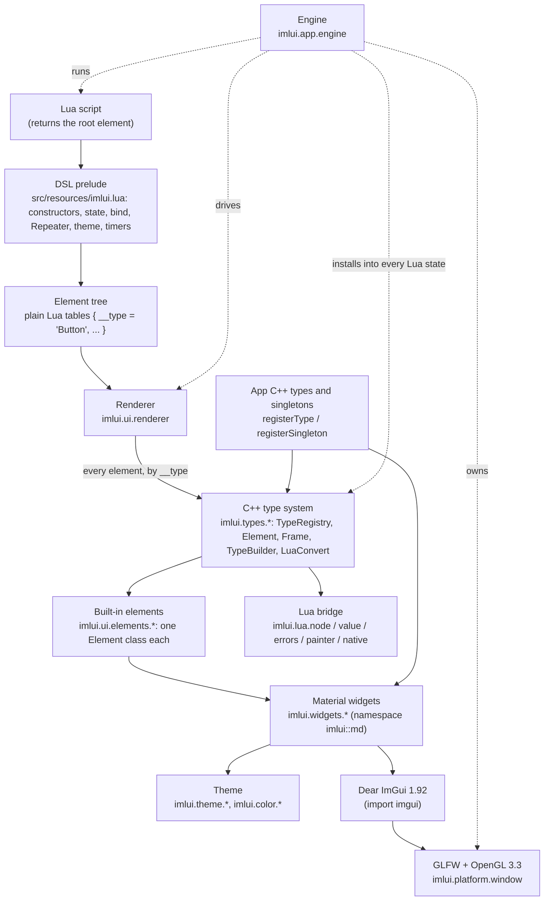

# Architecture

## Layers



| Layer | Responsibility |
|---|---|
| **Lua script** | Builds the element tree and returns the root. It owns all state and all decisions, including theme, window title and size. |
| **DSL prelude** (`src/resources/imlui.lua`) | Turns tables into elements (`Button {...}` tags the table with `__type`), and provides observable state, bindings, dynamic children, theme helpers, timers, the snackbar and logging. It also sets up the script environment, the `require` searcher for components and `ui.resource`. |
| **Element tree** | Ordinary Lua tables. Props are fields, children are the array part, and signals are `on*` functions. An element's identity is its C++ instance's id (`ScriptObject::objectId()`, see [Element identity](#element-identity)), from which its ImGui ID scope is made, so elements keep per-widget state such as animations and focus across frames, and an element never inherits a dead one's. |
| **Renderer** | Walks the tree on every rendered frame (immediate mode). For each element it applies the common props (`visible`, `enabled`, `tooltip`, the ID scope and the layout group) and hands the element to the type registry by its `__type` (through `Renderer::Types`, which `TypeRegistry` implements). An unregistered name reports "unknown element type". |
| **C++ type system** | `imlui.types.*`. C++ classes registered with `registerType<T>()` (elements, one instance per element table) and `registerSingleton()` (Lua globals), with properties, signals and methods declared through `TypeBuilder<T>`. To render an element, the registry syncs the declared properties from the element table into its instance and calls `Element::render(Frame&)`. Ticking elements (`Element::setTicking`) also get `tick(now)` at the start of every frame, rendered or not. See [Registering C++ types](extending.md). |
| **Built-in elements** | One `Element` class per module in `imlui.ui.elements.*` (`Button`, `Column`, `TabBar`, ...), registered by `registerBuiltinTypes()` exactly like an app's types. They call Material widgets, write two-way props back (`notify`) and emit signals. See [Elements](elements.md). |
| **Material widgets** | Material 3 controls drawn with ImGui primitives (`InvisibleButton` plus the draw list), using the current `imlui::theme()`. |
| **Resources** | `imlui.resources`. Every file the engine and the scripts load (Lua, fonts, data) is a resource named `prefix:/path` and served by stacked mounts. See [Resources](#resources). |
| **ImGui / platform** | Dear ImGui with the GLFW and OpenGL 3 backends, behind the `imgui` and `imlui.platform.window` wrapper modules. |

## Frame loop

`Engine::run()` does the following:

1. Creates the window **hidden**, sets the content scale from the monitor, logs the mounts, loads Roboto and
   Material Icons from `imlui:/fonts/`, applies the default theme, and loads the entry script.
2. Applies the root element's `title` and `width`/`height` (dp, multiplied by the content scale) to the native
   window, centers it and shows it.
3. Each loop iteration:
   - Every 400 ms, compares the modification times of the watched resources (hot reload). A change, or a `reload()` call, triggers
     `reloadNow()`.
   - Computes how long it may sleep: until the next **requested frame** (see below) or the next file check,
     whichever comes first. With nothing pending, that's the 400 ms hot-reload interval (or forever without hot
     reload). While minimized it sleeps at least 100 ms.
   - `window.waitEvents(timeout)` (`glfwWaitEventsTimeout`). Input or window events start a **settle period** of
     0.3 s, during which every iteration renders, so transitions and hover layers finish.
   - Runs the functions other threads queued with `imlui::post()` / `Engine::post()` (`imlui.ui.main_thread`;
     one that throws is reported like a script error). They may `notify()` and so request a frame.
   - `renderFrame()`, but only if a frame is due. Otherwise the loop goes back to sleep without rendering.

### On-demand rendering

`imlui.ui.frame_request` keeps the pending frame requests: `requestFrame()` (as soon as possible),
`requestFrameAfter(seconds)` and `requestFramesFor(seconds)` (continuously, the settle period).
`secondsUntilFrame()` tells the loop when the next frame is due. At the start of a frame,
`beginFrameRequests()` drops the requests that frame serves, so anything that still needs frames asks again while
it renders. Requests that come in while the loop sleeps wake it through `glfwPostEmptyEvent()`.

Who requests frames:

| Source | Request |
|---|---|
| Input and window events (mouse, keys, focus, resize, DPI change) | the 0.3 s settle period |
| `md::animate` / `md::stateLayer` (every Material transition) | a frame while the value is still moving |
| Indeterminate `ProgressBar`, `CircularProgress`, `BusyIndicator` | every frame |
| `Canvas { animated = true }` | every frame |
| `Timer` elements | a frame when the interval is due |
| `ScriptObject::notify` / `ScriptObject::emit` (C++ types), `Engine::post` | a frame (waking the loop if it sleeps) |
| Lua timers: `ui.__tick` returns the seconds until the next `setTimeout`/`setInterval` | a frame then |
| `Snackbar` | every frame while it slides in or fades out, and a frame when the fade starts |
| Tooltips | a frame every 100 ms while an item is hovered but the tooltip delay hasn't passed |
| An active text field | a frame every 100 ms for the caret blink |
| A held mouse button | frames at 30 Hz (repeat buttons, drags that pause) |
| `ui.requestFrame(ms?)`, `ui.setZoom`, `native.injectMouse` | a frame (or the settle period) |
| A reload | the settle period |

`md::animate` caps the frame time it advances by at 1/30 s, so a transition that starts on the first frame after
a long sleep doesn't jump to its end.

### Scaling

`imlui.theme.dpi` holds the monitor **content scale** and the user **zoom**. `dpiScale()` is their product, and
`dp(v)` converts with it. The window reports content scale changes (`glfwSetWindowContentScaleCallback`), and
`ui.setZoom` and the zoom shortcuts schedule a zoom change. At the start of the next frame, `syncScale()` applies
the zoom and, if the effective scale changed, calls `reapplyTheme()`: the style is rebuilt from an unscaled
`ImGuiStyle`, then `ScaleAllSizes(dpiScale())` and `FontScaleDpi = dpiScale()` are applied, as for any new
theme. With `GLFW_SCALE_TO_MONITOR`, Windows resizes the native window itself when it moves to another monitor.

### Rendering a frame

`renderFrame()` renders one complete frame:

1. `beginFrameRequests()`, then **`syncScale()`**, which applies a pending zoom and the pending theme. `theme{}`
   and `setTheme` only *schedule* a theme. It's applied here, between frames, so a click handler can change the
   theme in the middle of a frame without breaking that frame's ImGui style stack. If only the scale changed, the
   current theme is re-applied.
2. `window.beginFrame()`, which starts a new ImGui frame. Then the zoom shortcuts are handled.
3. `ui.__tick(now)`: runs due `setTimeout`/`setInterval` timers (each in `xpcall`, so one failing callback is
   reported and doesn't skip the rest), then ticks the C++ ticking elements (`Timer`;
   `require("imlui.types").tick(now)`, synced first, rendered or not), then the `onFrame` callbacks, and returns
   the seconds until the next timer. If an inline container dropped children on the last frame (a rebuilt or
   removed `Repeater` delegate, a replaced `Loader` / `Responsive` item) and ticking elements exist, it runs a full
   garbage collection before ticking, so a dropped `Timer` that nothing references stops now.
4. Renders the root element, inside `luaui::renderProtected` (see the error overlay below).
5. Renders **overlays**: the children of `ui.__overlays`, protected the same way. Today that's the app-wide
   `Snackbar` element driven by `snackbar()`. Overlays draw above everything else.
6. Draws the **error overlay** if any script errors were recorded (see below).
7. `window.endFrame()`: clears to the current `WindowBg` color, renders the ImGui draw data and swaps buffers.
8. Copies `Renderer::windowTitle()` to the native window: the root `ApplicationWindow`'s `title` prop if it has
   one, else the last `ui.setTitle()` (the `setTitle` hook stores it in the renderer), else `"imlui"`. The native
   title is only updated when it changes.

**Live resize.** On Windows, the OS runs a modal loop while the user drags the window border, so
`glfwWaitEventsTimeout()` doesn't return. The engine registers `renderFrame` as the window's **refresh callback**, and
GLFW calls it from its refresh and framebuffer-size callbacks. The UI then lays itself out again during the drag.

**Error overlay.** All calls into Lua go through `luaui::safeCall`, which runs `pcall` with a traceback handler.
Errors are logged with the source tag `lua`, deduplicated, and capped at the last 32. While any are recorded, a
panel with the `errorContainer` color sits at the bottom center of the window, with **Dismiss** (clears the list)
and **Reload** buttons. An error in a binding or handler only affects that value or call, and the rest of the UI
keeps rendering. Reads and writes of a `bind(t, k)` source go through `safeCall` too (a small C function doing
`t[k]` / `t[k] = v`), since a `state{}` proxy's `__newindex` runs `watch()` callbacks.

Lua is compiled as C++ (`external/lua_cxx/imlui_lua.cpp`), so a Lua error is a C++ exception (`lua::Raised`)
instead of a `longjmp`: it unwinds the C++ frames between the raise and the protected call that catches it, and their
destructors run. Code at the Lua/C++ boundary may hold C++ objects (strings, RAII guards) and raise anywhere,
including inside a catch block. Two rules remain: C++ code never swallows a `lua::Raised` (a `catch (...)` that may
see one rethrows it first: `catch (const lua::Raised&) { throw; }`), and a destructor that touches the Lua stack
doesn't drop the error value on top while one unwinds it (`lua::StackGuard` leaves the stack alone then).

An error raised outside any `pcall` still reaches the panic handler, and Lua aborts the process. As a last line of
defence the render pass (step 4, and the overlays in step 5) runs inside `luaui::renderProtected`
(`imlui.lua.protected_render`): a C function called with `safeCall`, so an unforeseen error in it is reported like
the others, and `ImGui::ErrorRecoveryTryToRecoverState` then closes the windows, tables and Push/Pop stacks the pass
left open, so the frame still ends. The rest of that pass is skipped, so this is not error handling: code that calls
into Lua while rendering still uses `safeCall`. The engine also installs `luaui::panicHandler`, which logs an error
that escapes even that before Lua aborts.

C++ exceptions become Lua errors with a message at the library's C functions: methods (`TypeBuilder`, a Lua error
`Gauge:reset: ...`), the `imlui.native` functions (the host's `NativeHooks`, theme and font loading: a Lua error
`imlui.native.quit: ...`), `imlui.types.tick` and the render pass (`luaui::catchCxx`, which raises
`<where>: <what>` and lets a Lua error pass). Property hooks, `componentComplete()`, `tick()` and `destroyed()` (from
`__gc`, which must never raise) are reported as script errors instead (`luaui::reportCxx`), and the `imlui.resource`
functions return nil and a message. A C++ exception that reaches a protected call without that (a bug) still
doesn't corrupt anything: the build maps a `std::bad_alloc` to a Lua memory error (`"not enough memory"`), and any
other exception to Lua's status -1, an error without a usable message (upstream Lua's behaviour). The property sync
of a typed element runs as a protected call, so a Lua error inside it (a metamethod of the element table, ...) is
reported, not raised.

## Property resolution

`luaui::Node` wraps an element table on the Lua stack. Every prop read (`n.string("text")`, `n.number("value")`,
`n.color("color")`, ...) **resolves** the raw field:

| Raw value | Read | Write-back (`Node::set`, when a widget changes it) |
|---|---|---|
| plain value, `text = "Hi"` | the value | stored on the element (`self.text = ...`) |
| function, `text = function(self) ... end` | called as `fn(self)` on **every read**, every frame (a *binding*) | **ignored**: the binding owns the value, so the widget snaps back to what the function returns |
| `bind(t, "k")` | `t.k` | `t.k = v` |
| `bind(getter, setter)` | `getter()` | `setter(v)` |

Because bindings are evaluated every frame, a UI that reads a `state{}` (or any table) inside a function always
shows current data. No dependency tracking is needed. `watch()` is only for side effects. "Every frame" means
every *rendered* frame: state changed by input handlers or timers is shown because those render a frame anyway.
Only a binding whose value changes by itself (for example from `time()`) needs `requestFrame()`.

A bind object is recognized by a raw `__bind` field, and its `t`, `k`, `get` and `set` fields are read raw too
(here and in the DSL): a value with an `__index` metamethod (a proxy, an object) is a plain value, and its
`__index` doesn't run.

Type coercion: numbers read where strings are expected are converted. Other values convert like `tostring()`; a
`__tostring` that raises is reported for that value (which reads as `""`) instead of cutting the pass short. Colors accept a role name, `role/alpha`,
hex, or `{r, g, b, a}` (see [Theming](theming.md#color-specs)). `Node::text()` returns the `text` prop, or the
first positional string: `Button { "OK" }` is the same as `Button { text = "OK" }`.

## Signals

Handlers are `on*` fields called as `handler(self, ...args)` through `safeCall`. Return values are ignored, and
errors go to the error overlay. Which signals exist and what arguments they get is listed per element in
[Elements](elements.md). A widget that changes a two-way prop writes the value first and then emits the signal,
so the handler already sees the new state.

## Children and inline containers

`Renderer::forEachChild` gets an element's children from one of two places:

- the array part of the table, or
- the result of `self.__children(self)` if that function exists. The prelude sets it for `Repeater`, `ListView`,
  `If`, `Loader` and `Responsive`.

Children whose table has `__inline = true` (`Repeater`, `If`, `Loader`, `Responsive`) are **spliced into the parent**: their
own children are laid out as direct children of the parent. That's why a `Repeater` inside a `Row` flows
horizontally. `visible = false` on an inline container hides all of its children. `ListView` isn't inline. It's
a scrolling `ScrollView` whose children come from `model`/`delegate`.

Layout notes. ImGui lays items out as they are submitted, so a container must decide where a child goes, and how
much width it gets, before the child draws. imlui's layout is built on that: **constraints go down** (layout boxes),
**sizes come up** (intrinsic sizes, else the layout cache), and a stale size **converges** within a frame.

- Each **visual** element is wrapped in an ImGui group, so it counts as exactly one layout item (a label plus a
  field behaves as one item in a `Row`), and its group's size is what the layout measures.
- **Non-visual** elements (`ApplicationWindow`, `Window`, `Dialog`, `ModalNavigationDrawer`, `Snackbar`, `Timer`,
  `ImGuiDemo`, any registered with `visual = false`, and typed elements declared `nonVisual()`) take no layout
  space or spacing.
- **Constraints go down through layout boxes** (`imlui.ui.layout_box`). A container that gives its children less
  than the ImGui window's content region pushes a box (`layout::BoxScope`, a right edge in screen coordinates): a
  `Column` with a `width` or `padding`, each `Grid` cell, each `Row` child (`Frame::Child::render(right)`).
  Containers that open a region (`Card`, `ScrollView`, `Window`, `Dialog`, `ApplicationWindow`) push a root box for
  it. Everything that sizes, aligns or wraps by "the available width" reads the box, never
  `ImGui::GetContentRegionAvail()`: `resolveSize` through `Frame::resolvedWidth/resolvedHeight` and `md::itemWidth`,
  `md::text` (`align`, `wrap`), `md::divider`, the stack `align`, and the containers that fill. The available width
  is `box right - cursor x`, so `Indent`, `SameLine` and a layout's x positions shrink it. A box also sets ImGui's
  item width and text wrap position (`PushItemWidth`, `PushTextWrapPos`), so raw ImGui widgets in a custom element
  follow it. A box belongs to the ImGui window it was pushed in: in another window (a popup, a child window without
  a box of its own) the queries read that window's content region, and where ImGui narrows the region under a box
  (a table cell), the narrower edge wins. No ImGui internals are touched.
- **The fill policy lives in the type.** Whether an unset `width` fills is declared once, with
  `TypeBuilder::fillsWidth()` / `fillsWidthWhen(pred)` (`Card`, `TextField`, `Slider`, `Grid`, `ScrollView`,
  `Table`, `TabBar`, `Section`, `ListItem`, `NavigationItem`, `Plot`, `Canvas`, `TopAppBar`, `NavigationBar`,
  `Divider`; wrapping `Text`, `Spacer { fill }`). The element's `Frame` applies it (`size("width")` reads `-1`,
  `resolvedWidth()` fills), layouts read it before rendering (`Frame::Child::fillsWidth()`), and the `md::` widgets
  have no fill default of their own: to them a width of 0 is their natural width.
- **Sizes come up**, before rendering when they can: an element that can tell its size cheaply implements
  `Element::intrinsicSize(frame, maxWidth)` (`Text` unwrapped and start-aligned, `Icon`, `Button`, `IconButton`,
  `Spacer`; measured by the same helpers that draw them: `md::textSize`, `md::buttonSize`, `md::iconSize`,
  `md::iconButtonSize`). Otherwise the size comes from the **layout cache** (`imlui.ui.layout_cache`): the
  `Renderer` records every visual element's group size under its ImGui ID (`Frame::Child::id()`), and a layout
  reads it on the next frame. `Frame::Child::expectedSize/expectedWidth/expectedHeight` give the intrinsic size,
  else the cached one: `Row` (non-fill widths, heights for `align`), the stack `align`, `TopAppBar` actions and
  `NavigationRail` destinations place children by them. Containers' own aggregates go through the cache too: an
  elevated `Card`'s shadow height, and an auto-sized window's widest claim and widest aligned child.
- **Convergence.** Placing a child by a size tells the cache so (`expectedWidth`/`lastWidth` and friends, or
  `layout::assumeWidth/assumeHeight`); when the child then renders at another size (by more than half a pixel), the
  cache requests another frame. Rendering is on demand, so without this a label a `Timer` or a posted change made
  longer would stay misplaced until the next input; with it the layout settles by itself, and a settled layout asks
  for nothing. A size that keeps changing for more than `layout::maxSettleFrames` (8) frames in a row stops asking
  (logged once at debug level), so a layout that can't settle doesn't render forever.
- **Retention.** A hidden page (another `TabBar` tab, an `If` branch, a collapsed `Section`) keeps its sizes, so it
  is in place, and seen, on the frame it comes back. An entry is dropped only when it is old both in frames and in
  time (`layout::keepFrames` 600 frames and `layout::keepSeconds` 60s: on-demand rendering renders few frames while
  idle, an animation many a second), and above `layout::maxEntries` (16384, about 2 MB) the least recently used go
  first (elements that come and go every frame); entries used on this frame or the last are never dropped. Keys are
  the element's ImGui ID in the parent's ID scope, made from its identity (see [Element identity](#element-identity)),
  stable for as long as the element lives: `TabBar` pages are the same elements every time, and `Repeater`/`ListView`
  keep a delegate while the item at its index doesn't change. A new element never finds a dead one's entry, even
  when Lua allocated its table at the dead one's address. A new ImGui context starts empty.
- **First appearance.** A child with neither an intrinsic size nor a cached one, which a layout must place
  horizontally by its width (under a non-start stack `align`; in a `Row` that has fills or justifies; a `TopAppBar`
  action; a non-filling `NavigationRail` child), renders **unseen** for its first frame
  (`Frame::Child::renderUnseen()`: an empty clip rect, so it is measured but nothing is drawn or hovered) and
  requests the next frame, which shows it in place. Only where a wrong guess would misplace things far: a `Row` that
  only aligns heights (the default `align = "center"`) shows such a child at the top and aligns the others among the
  known heights, then aligns them all on the requested frame, a vertical shift of a few pixels for one frame.
- **Fills under the stack `align`** need no size from anywhere: a fill or fill-minus child is the box's width (less
  N), placed by it and rendered in a box as wide as the stack from where it starts, so it resolves to that width
  again. A fill-minus child under `align = "center"` is centered with N/2 on each side on its first frame.
- **One sync a frame.** A layout's questions about a child (`fillsWidth`, `intrinsicSize`, `as<T>()`) and its
  render share one property sync while no Lua code that may change tables ran in between (`luaui::changes()`), so
  a `Row` child's bindings run once a frame; a handler that ran in between makes the render sync again. The skip
  doesn't trust the count alone: each sync keeps a fingerprint of the element table's declared fields (their raw
  values: numbers, booleans and strings by value, tables and functions by identity), and a skip compares it, so a
  write that bypassed the count (a raw `lua_setfield` from C++, a binding that writes its own element) still reaches
  the render on the same frame. A debug build reports such a write as a script error (`Gauge: a declared field of the
  element table changed without luaui::changes() counting it ...`): the code that made it probably writes other
  tables the same way, which no fingerprint sees (what bindings read, a nested model table changed in place). C++
  that writes Lua writes through `luaui::Node::set` (or calls `luaui::noteChange()`).
- **`Row` is a flex row.** Before rendering it asks each child whether it fills, gives the fills equal shares of
  the width the others take (their expected widths), and renders each fill in a box of its share (fill-minus
  resolves against it, wrapping text wraps at it). Every other child's box ends where the children after it start.
- **Auto-sized windows** (a `Window` with `autoResize`, a `Dialog`, menus, anchored popups, the error overlay) take
  their content's width, so nothing inside may size itself by the window's width: a fill would keep the window as
  wide as it ever was (ImGui fits the window to last frame's content, which the fill made as wide as the window).
  Their root box is **shrink-to-fit** (`layout::shrinkToFitBox(min, max)`): a fill (`availableWidth()`) resolves to
  the minimum content width, widened by `layout::claimWidth(natural)` to the widest claim of the last frame (menu
  rows claim their natural width, a `Dialog` its title), never to the window's width. Content may grow past it up to
  the maximum, where text wraps (`Box::wrapRight`). The stack `align` in such a box places children in the widest
  child of the last frame. So the window's width is a function of its content: stable frame to frame, and it
  shrinks back when the content gets shorter; a changed claim or widest child converges like any cached size.
  Sizes: `Window` fills `width` (240dp when unset) and wraps at the viewport's right edge; `Dialog` 280–560dp (or its
  `width`); menus at least 112dp, as wide as the widest row. The `Snackbar` doesn't auto-size at all: it computes its
  width (`md::snackbarWidth`: message + actions + padding within 344–672dp, at most the viewport less 32dp) and sets
  it; a longer message wraps inside it (`md::snackbarLines`) and only the height grows.
- **What still lags a frame:** the placement of children without an intrinsic size (any container, `TextField`,
  `Chip`, a custom element that doesn't implement it) is one frame behind when their size changes, and settles on
  the requested frame; wrapping or aligned `Text` has no intrinsic size. Such a child's first-ever appearance is
  unseen for a frame where its width places things, and a few pixels off vertically for a frame in a centered `Row`.

### Element identity

Every `ScriptObject` gets an id when it's constructed (`objectId()`): a 64-bit count, unique for the process's
lifetime and never reused. Lua frees an element table's memory when it collects it and may allocate the next table
at the same address, so an address isn't an identity across time; the id is. It identifies an element wherever
something outlives a frame:

- **ImGui ID scope and layout cache key.** The renderer asks the registry for the element's id
  (`Renderer::Types::elementId`, which creates the instance of a table built without the constructor) and pushes it
  as the element's ImGui ID scope; `Frame::Child::id()` is the same ID seen from the parent, and the layout cache
  key. So a new element never inherits a dead one's cached size (misplaced for a frame) or its ImGui state (an open
  tree, a scroll position, a text edit in progress). A container that renders a child's children itself pushes the
  child's scope with `Frame::Child::pushId()` (`TabBar`'s pages). An element without an instance (its constructor
  threw, which is reported) isn't rendered.
- **Ticking.** The ticking list holds `(id, Element*)`. `Element::tickingElements()` returns ids and
  `Element::findTicking(id)` the element only while that very element lives and ticks, so a `tick()` whose handler
  destroys a later element and creates another at its address can't make the loop tick the newcomer in the dead
  one's place.

A hot reload builds new elements, so they start fresh too: no cached sizes and no ImGui state from the old tree.

## Hot reload

`Engine::reloadNow()`:

1. Clears recorded errors and resets the theme to `Theme{}` (seed `#6750A4`, dark).
2. Creates a new `lua_State`, opens the standard libraries, registers `imlui.native` (a `package.preload`
   entry) and the Canvas painter metatable, and installs the registered C++ types and singletons
   (`TypeRegistry::install`: the `imlui.types` library the DSL constructors use, methods tables, singleton
   globals).
3. Registers the resource loader (`luaui::registerResources`): the `imlui.resource` library and a
   `package.searchers` entry that finds modules in `imlui:/`. `package.path` keeps Lua's default, for plain Lua
   libraries; imlui's own files never go through it.
4. Runs a boot chunk: `require("imlui")` (`imlui:/imlui.lua`), `ui.__load(entry)` (`app:/main.lua`, run in its
   own environment over `ui.env`, see [Resources](#resources)), and returns the root, `ui.__tick` and
   `ui.__overlays`.
5. On failure (syntax error, runtime error, or a non-table return), it closes the new state, points the
   singletons back at the old one, restores the previous theme and keeps the old UI. On success, it replaces the
   old state and applies the window title and size (size only if it changed since the last load). Closing a
   state destroys the C++ instances of its elements and detaches the singletons from it.

The watcher polls `Resources::modified` for every `.lua` file in the mounted prefixes (`Resources::listRecursive`)
and for every resource a Lua state read or loaded. Only directory mounts report times; files in immutable mounts
(embedded data, `.pak` archives) never change while the app runs. With the same check, `ImageCache::refresh` drops
the images whose file changed; they're decoded again at their next use, without a reload.

## Resources

`Resources` (module `imlui.resources`) maps names to files. A name is `prefix:/path`: the prefix is a namespace
(`app` for the application, `imlui` for the library, others for libraries and plugins) and the path is
`/`-separated. Names are normalized (`app:/a/./b//c.lua` is `app:/a/b/c.lua`), and a `..` that would leave the
prefix's root, a backslash, a `:` in the path or a malformed prefix makes a name invalid. Prefixes are lowercase and
at least two characters long, so OS paths such as `C:/x` or `/etc/x` are never names (`imlui.resources.name`).

Each prefix has a stack of **mounts** (`Mount`), each at a mount point: the prefix root (`app:/`) or a folder in it
(`imlui:/fonts/`). A name is served by the newest mount that has it, so a later mount overrides single files of an
earlier one. `read` returns a `ResourceData` (module `imlui.resources.data`): the bytes and a shared handle that
keeps them alive; `exists`, `list`, `listRecursive`, `modified` and `origin` complete the API. `readText` returns a
copy as a string.

**Lifetime of the bytes.** They stay valid while the `ResourceData` (or a copy of it) exists **and** the mount that
returned it does. Immutable mounts serve memory they own for their whole lifetime (`owner()` is null, zero-copy). A
`DirectoryMount` reads a file into a buffer that its cache and the handles share; when the file changes, the cache
moves on to a new buffer and the old one is freed with its last handle. So whoever keeps pointing into the bytes
keeps the handle: the font library holds one per atlas font, the icon font one for the icon atlas font; images copy
their pixels when they're decoded and Lua copies the text it loads or reads, so they drop theirs at once.
Hot-reloading a large file therefore holds at most the bytes in use plus the latest version, not every version ever
read.

| Mount | Notes |
|---|---|
| `DirectoryMount` | A folder on disk. Reads are cached per file while its time and size are unchanged; the cache keeps each file's latest buffer only (a removed file's is dropped), older ones live as long as a `ResourceData` holds them. Reports modification times. A changed file that can't be read at the moment (an editor holds it without sharing while it saves) is served from its previous buffer, and `modified` reports that buffer's time until a read succeeds, so hot reload tries again on its next poll. An optional `ResourceSelection` (a dev source folder's manifest group, below) limits it to the files the manifest selects: the others aren't read, found, timed or listed, and folders holding no selected file don't show. It never throws: a name that isn't valid UTF-8, a file too large to allocate or a folder that can't be listed reads as missing. Names are case-sensitive, as in the embedded and `.pak` mounts, also on a file system that isn't (Windows, macOS): a name whose spelling on disk differs in case in any segment isn't found, and a warning names the spelling on disk, so a misspelled name fails in development, not once shipped (each folder's entry names are cached while its time is unchanged). |
| `EmbeddedMount` | Files compiled into the executable by `imlui_add_resources` (see [Embedding and archives](#embedding-and-archives)). Immutable. |
| `PakMount` | A `.pak` archive, read into memory once when it's opened. No memory mapping: archives are small, and a plain read is portable. Immutable; the archive names its own mount point. |

`EmbeddedMount` and `PakMount` share `PackedMount`: a sorted table of files, each stored as is or as one zstd frame.
A stored file is served straight from the embedded data or the archive buffer (zero-copy). A compressed one is
decompressed on its first read, under that file's own lock (files decompress in parallel, each once), and the
buffer is kept until the mount is destroyed, so the bytes stay valid as long as the mount. Corrupt compressed data
reads as a missing file and is logged once (the failure is remembered); a file too large to allocate reads as missing
and is logged, without an exception (a failed read is "not found").

`defaultConfig` builds the stack from the bottom (overridden) to the top (wins):

1. **Embedded:** the files of every `ResourcePackage` (module `imlui.resources.package`: a mount point, the files,
   a dev source folder and the paths in it to hide). A package built without embedding (`IMLUI_EMBED_RESOURCES=OFF`) has no files here. The library's own come first, always: `imlui:/` (`src/resources/`) and `imlui:/fonts/` (Roboto,
   Material Icons, the codepoints and the font licenses), the two groups of the library's manifest. Then the host's
   packages, the `app` argument, such as `imlui::embedded::my_app::packages()`.
2. **Archives:** every `*.pak` next to the executable, in file name order (`mountPaks`), each at the mount point
   stored in it. An archive that can't be read is logged and skipped: `PakMount::open` checks the magic before
   reading the file whole, refuses one over `pakMaxArchiveSize` (4 GiB), reports an allocation that fails, and never
   throws, so junk named `*.pak` can't stop the app from starting.
3. **Override folders** next to the executable, named after a prefix, where they exist: `<exe folder>/app/` at
   `app:/`, `<exe folder>/imlui/` at `imlui:/` (so `imlui/fonts/` overrides fonts), and the same for the prefix of
   any other package.
4. **Dev source folders:** each package's `sourceDir` at its mount point, where the folder exists. Only dev builds
   have them (`IMLUI_DEV_PATHS=ON` makes `imlui_add_resources` bake each manifest group's absolute `base` folder
   into the generated module);
   the environment variable `IMLUI_DEV_PATHS=0` skips them at runtime. A package without embedded files
   (`IMLUI_EMBED_RESOURCES=OFF`, the default in dev builds) has only this folder: it's mounted even with
   `IMLUI_DEV_PATHS=0`, and when it doesn't exist (the executable was moved to another machine) an error names it.
   The folder is mounted with the package's `selection` (module `imlui.resources.selection`: the group's `files`,
   `include` and `exclude`, and the manifest's own path, which no pattern matches), so it serves exactly the files
   the build embeds or packs: a file next to the sources that the manifest doesn't select isn't found in development
   either, instead of failing only once shipped. A new file that matches a pattern is served at once (hot reload),
   as the next build would embed it. So there is no `imlui:/resources.lua` or `app:/resources.lua` in dev builds
   either, unless the manifest lists itself in `files`, and then it's served from the folder like any other file.

The executable's folder (archives and override folders) is where the OS says the executable is
(`imlui.platform.process`: `GetModuleFileNameW` on Windows, `/proc/self/exe` on Linux) when `argv` is the process's
own command line, not `argv[0]`, which is a bare name when the program was found through `PATH` and relative to the
current folder otherwise. A list the host makes up (tests) is taken as given. On Windows the script argument is
taken from the UTF-16 command line (`CommandLineToArgvW`), since `argv` is in the ANSI code page.

The entry is `app:/main.lua` (`EngineConfig::entry`, which a host can change). A script on the command line replaces
the app: no package, archive or folder is mounted at `app:/`; the script's folder is mounted there instead (on top,
even when it doesn't exist, so the error names it) and the entry becomes `app:/<file name>`. A relative script path
is resolved against the current directory, then against the executable's folder (scripts shipped next to it).

So a dev build reads `src/resources/`, the fonts and the app from the source tree (hot reload, nothing embedded), and a release build runs
from its embedded data alone, while a `.pak` or loose files next to it still override single files. Hosts name no file
paths.

The fonts are added to the ImGui atlas without a copy
(`FontDataOwnedByAtlas = false`), pointing into the bytes `Resources::read` returned. The font library keeps their
`ResourceData` with each atlas font and drops it when the font leaves the atlas (`useFontSet` removes fonts replaced
by newer bytes; `clearFontLibrary` when the atlas is cleared or destroyed). Immutable mounts own those bytes, so the
`Resources` in `EngineConfig` must still outlive the atlas. The Engine keeps it for its whole lifetime, and the atlas
dies with the window in `run()`. Before a font goes to the atlas, `checkFont` (module `imlui.theme.font_check`)
checks its structure: ImGui parses fonts with stb_truetype, which trusts the data, reads offsets without bounds
checks and aborts through `IM_ASSERT_USER_ERROR`/`STBTT_assert` on data it doesn't expect. The check walks what
stb_truetype reads when a font is added, when glyphs are looked up and when they are rasterized (the table directory,
`head`, `hhea`, `hmtx`, `maxp`, the Unicode `cmap` subtable it picks, `loca`, or the CFF header, INDEXes, DICTs,
Private DICTs and FDSelect). **TrueType outlines** (`glyf`) are decoded for every glyph the way `stbtt_GetGlyphShape`
decodes them when ImGui rasterizes one (class `Outlines`): `loca` offsets ascending and inside `glyf`; for a simple
glyph, the end points, the instruction length, the flags with their repeat counts and the 1- or 2-byte x and y
coordinates all inside the glyph's bytes; for a composite glyph, every part's flags, offset and scale inside the
glyph, no part placed by matching points (an `STBTT_assert`), no part that contains the glyph itself (stb_truetype
recurses without a limit: a stack overflow), at most 16 levels of nesting, at most 2^18 vertices and a bounded
amount of copying per glyph (parts used many times over), and every transformed coordinate within 16 bits
(stb_truetype converts it from float to `short`, undefined out of range). A last contour of one point off the curve
makes stb_truetype read one vertex past its array; real fonts (Calibri, Consolas) have such placeholder glyphs with a
box of zeros, which ImGui never draws, so it is rejected only in a glyph that can be drawn (its box isn't 0 wide or
high at 0) or in a part of one. It mirrors stb_truetype's parser rather than running it under a bounds-checking
reader, because stb_truetype reads glyph data through raw pointers (`ttUSHORT(p)`, `*points++`) that a reader can't
intercept. **What ImGui does with the result** is checked too: `hhea` must give the font a positive height
(ascender > descender: ImGui scales by its inverse, and a negative scale turns the rasterizer's edges upside down,
which trips its `STBTT_assert`s); a glyph's box (from its header, or for CFF from its charstring) must not be inverted
or more than 16 font heights wide or high (ImGui sizes the glyph's bitmap by it and `IM_ASSERT`s on a size <= 0 or
one its atlas can't hold); and a TrueType glyph whose box ends at or below the baseline must not have an outline that
rises above the baseline, curves included: its bitmap can then start at the baseline, and stb_truetype's rasterizer
asserts on an edge wholly above a bitmap's first row (it clamps such edges only elsewhere). That last check takes the
glyph's vertices from `stbtt_GetGlyphShape` itself, through the private copy below, once the outlines are known to be
sound. CFF outlines are programs: stb_truetype runs a glyph's charstring to get its box, which ImGui does for every
glyph it loads, so once the structure is sound `checkFont` runs every charstring through its own static copy of
stb_truetype, whose `STBTT_assert` records the failure (in `errno`) instead of aborting, and rejects the font if one
trips it (its CFF buffer reads are bounds-checked, so that is safe). Of the 283 fonts in a Windows 11 `Fonts` folder,
`checkFont` rejects the four symbol fonts without a Unicode character map, one that isn't a font, and Linux Biolinum
Regular (a drawn glyph with a lone off-curve point as its last contour). A damaged font is reported like a missing
one and the built-in face is used.

Lua sees resources in two ways (`imlui.lua.resources`):

- Module search. `require("imlui")` and `require("a.b")` look in `imlui:/` (`a/b.lua`, then `a/b/init.lua`) through a
  `package.searchers` entry. `src/resources/imlui.lua` puts its own searcher in front of it, for components next to the
  entry script (`ui.__dir`). Chunks are named `@app:/main.lua`, so errors and tracebacks read `app:/main.lua:12: ...`.
- Script environments. Every UI script loaded as a resource (the entry script by `ui.__load`, components by the
  searcher) runs in its own environment (`chunkEnv`): a proxy over `ui.env` whose `ui`, and free names `Image`,
  `theme`, `themeState` and `resource`, are the script's own versions, bound to its full name when it is loaded. So
  relative names (`ui.resource.*`, `Image { source }`, theme fonts) resolve against the folder of the script whose
  code makes the call, wherever that code runs, also in tail calls (`return ui.resource.read("x")`), where Lua drops
  the caller's frame. Everything else reads and writes the shared `ui.env` and `ui` (globals, ids, `ui.x = ...`), as
  before. Code that uses the plain `ui` table (`require("imlui")`, or code loaded from a string in `ui.env`) finds the
  calling script from the caller's chunk name on the stack instead, falls back to the main script, and raises a clear
  error for a relative `ui.resource` name in a tail call, the one case it can't resolve.
- `ui.resource.read`, `exists` and `url`, and `ui.theme { fonts = ... }`: relative names resolve as above (fonts in
  C++, `readFonts(state, idx, fonts, script)`, with the script passed as `native.setTheme`'s second argument).

### Images

`Image` elements draw from the `ImageCache` (module `imlui.image.image_cache`) that the Engine owns and hands to the
`Renderer` (`Frame::images()`). The `Image` constructor in `src/resources/imlui.lua` stores the creating script's name
as `__base`, and the element resolves `source` against it at every render. The cache decodes a name once with stb_image
(PNG and JPEG) and keeps the pixels as an `ImTextureData` registered with `ImGui::RegisterUserTexture`: ImGui 1.92's
texture list, so the OpenGL backend creates the GL texture before the first frame that draws it (status `WantCreate`)
and no GL call is made outside the backend. A failure (missing file, not an image) is cached too and reported once.
`refresh()` drops changed images: a texture the backend has uploaded is marked `WantDestroyNextFrame`, the backend
destroys it after the next frame and `collect()` (after each frame) deletes it; one that was never uploaded is deleted
at once. At shutdown the backend destroys the remaining textures with the window, and the cache deletes the data after
the ImGui context is gone. `smooth = false` uses the backend's `DrawCallback_SetSamplerNearest`/`Linear` draw callbacks.

### Resource manifests

What a resource package holds is described in Lua, like Qt's `.qrc` files: a **manifest**, by convention named
`resources.lua`, returns one group or a list of groups. Each group is a set of files mounted at one mount point:

```lua
return {
    prefix = "app",                        -- required: `app`, `imlui`, a library's own prefix
    mount = "ui",                          -- optional folder under the prefix: app:/ui/ (default: the root)
    base = ".",                            -- the folder paths are relative to, relative to the manifest (default ".")
    files = { "main.lua", "data/a.json" }, -- explicit files
    include = { "**/*.lua", "*.png" },     -- glob patterns, relative to base
    exclude = { "tests/**" },              -- patterns removed from what `include` matched
    compress = { ["big.bin"] = false },    -- per file: true always compresses, false never (overrides the size rule)
}
```

- `files`, `include` and `exclude` take a string or a list of strings. A group needs `files`, `include` or both; the
  result is their union, sorted. `exclude` filters only what `include` matched; explicit `files` are always kept.
- Patterns: `*` matches any characters but `/`, `?` one character but `/`, `**` any characters including `/`; as a
  whole segment, `**/` also matches no folder (`**/*.lua` matches `main.lua` and `ui/Card.lua`). Files added later
  that match a pattern are picked up on the next build. Only the folders a pattern can match under are scanned (its
  leading segments without a wildcard: `ui/icons/*.png` scans `ui/icons/`).
- The manifest itself is never matched by a pattern, so a manifest next to the files isn't embedded; list it in
  `files` to embed it (a dev build's folder mount then serves it too).
- A listed file must be spelled as on disk, case included (`Main.lua` for `main.lua` is an error): resource names are
  case-sensitive, and on a file system that ignores case the wrong spelling would be embedded under a name the dev
  folder mount doesn't serve.
- Every path stays under `base`: a `..` segment, an absolute path, a `\` or a `:` is an error, and so is a listed
  file that doesn't exist, an unknown field, a value of the wrong type, a string that isn't valid UTF-8, a missing or
  malformed `prefix`, a group that selects nothing, and a `compress` entry that isn't one of the group's files.
  Errors name the manifest and, in a list, the group (`resources.lua: group 2: 'prefix' is required`).
- The manifest runs in a sandbox: a fresh Lua state with the base library only (`pairs`, `ipairs`, `tostring`,
  `error`, ...), without `dofile`, `loadfile`, `load` and `collectgarbage`, and no `io`, `os`, `require`, `string`
  or `debug`. Bytecode is refused. A Lua error is reported at the manifest's `file:line`. It may run at most
  10 million Lua instructions and use at most 64 MiB (`manifestMaxInstructions`, `manifestMaxMemory`), so an endless
  loop or a runaway table fails the build with an error instead of hanging it.

The tools evaluate manifests at build time (`imlui.tools.resource_manifest`, with `imlui.resources.glob`), through the
`lua` wrapper module, which is its own library (`imlui_lua`) because `imlui_rc` can't link the `imlui` library it
embeds files into. The library's manifest is `src/resources/resources.lua`: the folder it sits in (`base = "."`, the
manifest itself excluded) at `imlui:/` and the fonts from `external/fonts/` (`base = "../../external/fonts"`) at
`imlui:/fonts/`; it lives in `src/resources/`, a folder of resources only, so no pattern can pick up a `.cpp` or
`.cppm`. There are two test manifests: `tests/data/smoke_app/resources.lua` (the smoke app, embedded into
`imlui_smoke_host`, into the tests twice: forced embedded and forced not embedded, and packed into `smoke_app.pak` for the dev/shipped parity test `smoke.modes`) and `tests/data/smoke_pak.lua` (the test archive). An app has its own the same way, in
`src/resources/` next to its scripts (see [Getting started](getting-started.md#using-imlui-in-your-app)).

### Embedding and archives

`imlui_add_resources(<target> <manifest> [NAME <name>] [EMBED ON|OFF])` (`cmake/ImluiResources.cmake`) embeds the
files of a manifest into a target, when the build embeds (see [Embedding or not](#embedding-or-not) below). `NAME` defaults to the manifest's folder name (lowercased, other characters as `_`). At build
time the `imlui_rc` tool (`tools/`) encodes each file and writes `<name>.bin` (the stored bytes of every group, back
to back) and the module `imlui.embedded.<name>` into the build tree. The module pulls the blob in with `#embed`, a
clang extension in C++ whose `-Wc23-extensions` warning is turned off only around that line of the generated file.
It holds one static table of `EmbeddedMount::Record`s `{path, offset, storedSize, size, compressed}` per group and
exports:

- `imlui::embedded::<name>::packages()`: a `std::vector<ResourcePackage>`, one per group in manifest order, each
  with its mount point, its `EmbeddedMount` (created on first use and shared) and, when the build has
  `IMLUI_DEV_PATHS=ON` (`imlui_rc --dev-paths`), the group's absolute `base` folder as the dev source folder ("" with
  `OFF`, so a release binary holds no source paths) and its `selection`: the group's `files`, `include` and
  `exclude`, plus the manifest's path in that folder when it lies there (nullopt without a source folder). Hosts
  pass it to `defaultConfig`.
- `mount(Resources&)`: mounts every group's files at its mount point.

A mount's origin is `embedded '<name>'`, or `embedded '<name> (<mount point>)'` when the manifest has several groups.

Dependencies come from the tools, not from configure-time globbing: `imlui_rc` writes a dependency file (`<name>.d`,
`add_custom_command(DEPFILE)`, `imlui.tools.depfile`) listing the manifest, every embedded file and every folder it
scanned, so editing the manifest or a file re-embeds. Ninja on Windows reads folder times from the parent folder's
listing, which NTFS updates lazily, so a file added to a scanned folder can be missed by the folder's time alone. The
custom target `imlui_resources_<target>_<name>_list` therefore runs `imlui_rc --list` on every build: it evaluates the
manifest and rewrites the file list (`<name>.files`, an input of the embedding) only when the set of files changed.
That's cheap (no file is read), and the tool rewrites its other outputs only when they change too, so touching a file
without changing it rebuilds nothing. Each output is replaced whole (written to `<file>.tmp` and renamed over it), so
an interrupted run never leaves a truncated blob or module that looks up to date. A changed blob rebuilds the module
even when the module's text is unchanged: clang lists a file pulled in with `#embed` in the module's own dependency
file, like a header.

#### Embedding or not

The CMake option `IMLUI_EMBED_RESOURCES` decides whether `imlui_add_resources` embeds; its default is the opposite of
`IMLUI_DEV_PATHS`: dev builds don't embed, release builds (`-DIMLUI_DEV_PATHS=OFF`) do. A dev build reads every file
from the source folders anyway (they're mounted on top), so embedding them would only make each edit of a Lua file,
an image or a font re-embed, recompile the generated module and relink. Without embedding, `imlui_rc --source-dirs`
generates the same module `imlui.embedded.<name>` with the same `packages()` and `mount()`, but no blob: each package
has its mount point, its group's `base` folder and selection, `files` is null, and `mount()` mounts the folders. The module
depends on the manifest only (no dependency file, no file list target), so editing, adding or removing a resource
file needs no build at all (`ninja: no work to do`), and hot reload picks it up. Changing the manifest regenerates
the module: the manifest is still evaluated at build time for its groups' mount points and folders.

`EMBED ON|OFF` overrides the option for one call (the library's `imlui_smoke_host` embeds always, so its smoke test
runs it alone in every configuration). Not embedding needs `IMLUI_DEV_PATHS=ON`, as the source folders are then the
only copy of the files: `IMLUI_EMBED_RESOURCES=OFF` with `IMLUI_DEV_PATHS=OFF` stops the configure with an error, and
so does `EMBED OFF` with `DEV_PATHS OFF` (which defaults to `IMLUI_DEV_PATHS`). `imlui_add_pak` always packs. The
generated files go to `imlui_resources/<target>/` in the current binary folder, so two targets may generate a module
of the same name (as the library's two variants below do).

**Compression** (`imlui.tools.resource_encoding`, shared by both tools): a file is stored as one zstd frame (level 19)
when it is at least 64 bytes, its extension isn't an already-compressed format (PNG, JPEG, zstd, zip, ...), and
compression saves at least 10 %. Otherwise it's stored as is. A manifest's `compress = { [path] = true|false }`
overrides that rule for single files (true compresses any non-empty file). `imlui.lua` shrinks to about a third,
the fonts to about half.

The library embeds its own files this way (`src/resources/resources.lua`, module `imlui.embedded.imlui` with two
packages), and so does every app (its `src/resources/resources.lua`, as `app:/`) and the test host `imlui_smoke_host`
(`imlui.embedded.smoke_app`).

The library's files live in their own targets, not in the modules' (`imlui_core`), so they come in two variants that
share one compiled `imlui_core` (`src/CMakeLists.txt`). `imlui_core` declares `defaultConfig()`, the only function
that uses them; `src/imlui/app/default_config.cpp`, an implementation unit of `imlui.app.config`, defines it next to
the generated module in each variant:

| Target | Embeds | Linked by |
|---|---|---|
| `imlui` (alias `imlui::imlui`) | as `IMLUI_EMBED_RESOURCES` says, with source folders as `IMLUI_DEV_PATHS` says; the module is public (the tests import it) | everything in the build tree: the tests, the tools that need the library, an app that adds imlui as a subproject |
| `imlui_files_install` (with `IMLUI_INSTALL=ON`) | always, without source folders; the module is private | nothing in the build: installed as `imlui::imlui_files`, which the installed `imlui::imlui` links |

So in a dev build, editing `src/resources/imlui.lua` re-embeds `imlui_files_install` only (embed, compile it, archive
it); `imlui`, the tests and the tools have nothing to rebuild. `imlui_core` never refers to the files (an app calls
`defaultConfig()` in the files' target, which calls `defaultConfigWith()` in `imlui_core`), so a single-pass linker
gets the libraries in a working order.

**`.pak` archives** (`imlui.resources.pak_format`) use the same encoding. The layout, with little-endian integers:

| Part | Contents |
|---|---|
| Header | `IMLUIPAK`, u32 version (1), u32 file count, u32 length + the mount point (`app:/`) |
| Index | per file: u32 length + path, u64 offset (from the start of the archive), u64 stored size, u64 size, u32 flags (bit 0: zstd) |
| Blobs | each file's stored bytes |

`parsePak` checks the magic and the version, that the mount point is a full folder name in canonical form (`app:/`,
`imlui:/fonts/`; not `app:/main.lua`, which would be mounted as a folder of that name), that every path is normalized and appears once and
every blob lies inside the archive, and caps the sizes, so a truncated or corrupt archive is rejected with a reason instead of being
read out of bounds.

`imlui_pack [--depfile <file>] <out.pak> <manifest>` builds an archive from a manifest, and
`imlui_add_pak(<name> <manifest> [OUTPUT <file>])` does it from CMake (by default `bin/<name>.pak`, next to the
executables, `bin/<config>/<name>.pak` with a multi-config generator; tracked like `imlui_add_resources`: a
dependency file and the list target `<name>_list`). `writePak` refuses what the reader would reject or a field would
truncate (a file over the size cap, an archive over `pakMaxArchiveSize`, a duplicate path, a string longer than its
u32 length), and `imlui_pack` writes
`<out.pak>.tmp` and renames it over the output, so a failed run never leaves a partial archive.
`imlui_pack <out.pak> <mount point> <base folder> [file...]` still builds one by hand (a folder under the base that
can't be listed fails the run rather than packing an incomplete archive). An archive keeps its single
mount point (format version 1 is unchanged), so **the groups of a manifest packed into one archive must share their
prefix**: the archive is mounted at the deepest folder that holds every group's mount point, and each group's files
are stored under their folder below it (`tools::mergeGroups`). The library's manifest, with groups at `imlui:/` and
`imlui:/fonts/`, packs into one archive at `imlui:/` holding `imlui.lua` and `fonts/Roboto-Regular.ttf`, which mounts
to the same names. Groups with different prefixes, or two groups putting a file at the same name, are an error: use
one manifest per prefix. A version 2 with a mount point per entry wasn't worth it, since a prefix-wide archive
already covers every folder of that prefix.

## Repository layout

imlui is a library repository; apps live in their own repositories and add it with `add_subdirectory` (a git
submodule), `FetchContent`, or `find_package` on an installed copy (see
[Getting started](getting-started.md#1-adding-imlui-to-your-project); [imlui-example](getting-started.md#the-example-app-imlui-example),
which uses a submodule, is the example).

| Path | What |
|---|---|
| `CMakeLists.txt` | Project setup: `project(imlui VERSION 0.1.0)`, the options `IMLUI_BUILD_TESTS` and `IMLUI_INSTALL` (both default `ON` only at the top level), the CMake helpers, the install folders (`GNUInstallDirs`), `external/`, `src/` (`add_subdirectory(src)`), the tools, the install rules (`IMLUI_INSTALL`), the tests and the `tidy` target (top level only). Paths are relative to the project (`PROJECT_SOURCE_DIR`, `CMAKE_CURRENT_*`), so it works as a subproject; it sets `CMAKE_RUNTIME_OUTPUT_DIRECTORY` (`bin/`) and `CMAKE_EXPORT_COMPILE_COMMANDS` only at the top level, and no global flags. |
| `cmake/` | `ImluiResources.cmake` (`imlui_add_resources`, `imlui_add_pak`, and the options `IMLUI_DEV_PATHS` and `IMLUI_EMBED_RESOURCES`: default the opposite of `IMLUI_DEV_PATHS`, both `OFF` is a configure error), `ImluiWarnings.cmake` (`imlui_set_warnings`, `imlui_set_hardening`), `ImluiSanitizers.cmake` (`IMLUI_SANITIZERS`), `ImluiTidy.cmake`, `ImluiInstall.cmake` and `imluiConfig.cmake.in` (the install rules and the package, see [Install layout](#install-layout)). The functions are global once included, so a parent project calls them after `add_subdirectory`; the installed package's config includes `ImluiResources.cmake` and `ImluiWarnings.cmake` the same way. Each file has an include guard. The sanitizer flags are also usage requirements of `imlui_lua` (so of everything that links imlui), as importing a module needs the flags it was built with; an app includes `ImluiSanitizers.cmake` itself before `add_subdirectory` only to instrument its targets that don't link imlui. |
| `src/CMakeLists.txt` | The library targets: `imlui_lua` (`wrap/lua.cppm`), `imlui_glob` (`imlui/resources/glob.cppm`, shared with the resource tools), `imlui_core` (every other `.cppm` under `src/`, globbed, and the implementation unit `imlui/app/config.cpp`), `imlui` (alias `imlui::imlui`: the library's own files, `imlui_add_resources(imlui resources/resources.lua NAME imlui)`, and `imlui/app/default_config.cpp`, linking `imlui_core`), with `IMLUI_INSTALL=ON` the install's embedded copy `imlui_files_install` (see [Embedding or not](#embedding-or-not)), and their install rules (CMake records a module file set's install folder only from rules in the target's own directory). |
| `src/imlui/`, `src/wrap/` | The library's modules (see the module map below). |
| `src/resources/` | The library's resources: `resources.lua` (the manifest) and the Lua side (`imlui.lua`), embedded at `imlui:/`. No `.cppm` here, so the module globs never see it. |
| `tools/` | `imlui_rc` and `imlui_pack`, the build-time resource tools, with the aliases `imlui::imlui_rc` and `imlui::imlui_pack`. `imlui_add_resources` and `imlui_add_pak` run them by those names, which an installed package defines too (imported executables), so the helpers work the same in every mode. |
| `tests/` | `imlui_tests` (GoogleTest), `support/` (test-only modules), `smoke_host/` (the test app host `imlui_smoke_host`), `data/` (fixtures: `smoke_app/`, `smoke_pak.lua`, test images), `smoke_run.cmake`, `smoke_modes.cmake` (the dev/shipped parity test), `package/` (the package tests: a consumer app built with each way of adding imlui, see [Development](development.md#package-tests)). |
| `external/` | Vendored third-party code (see [Third-party code](#third-party-code)). |
| `docs/` | This documentation. |

## Install layout

With `IMLUI_INSTALL=ON` (the default when imlui is the top-level project), `cmake --install <build> --prefix <prefix>`
installs a CMake package that apps load with `find_package(imlui 0.1 CONFIG)` (`cmake/ImluiInstall.cmake`, and the
library's own rules in `src/CMakeLists.txt`):

| Path under `<prefix>` | What |
|---|---|
| `bin/` | `imlui_rc`, `imlui_pack`: imported as `imlui::imlui_rc`, `imlui::imlui_pack`, which the helpers run. |
| `lib/` | `imlui_core` (the modules, exported as `imlui::imlui`, which an app links), `imlui_files` (the library's own files, embedded, and `defaultConfig()`: `imlui::imlui_files`, linked by `imlui::imlui`), `imlui_lua` (`imlui::imlui_lua`), `imlui_glob` (`imlui::imlui_glob`), all static. The build tree's target `imlui` isn't installed. |
| `lib/imlui/` | The vendored static libraries the library needs: `imlui::ext_lua`, `ext_imgui`, `ext_glfw`, `ext_spdlog` (compiled, `SPDLOG_COMPILED_LIB`, bundled fmt), `ext_stb_image`, `ext_zstd` (the decompressor). Link-only for the app, except through the modules' BMIs. |
| `lib/cmake/imlui/` | `imluiConfig.cmake` (finds Threads and OpenGL, includes the targets and the helpers), `imluiConfigVersion.cmake` (`SameMinorVersion`: 0.1 accepts 0.1.*, not 0.2), `imluiTargets*.cmake`, `cxx-modules/` (which module each interface unit provides, per configuration), `ImluiResources.cmake`, `ImluiWarnings.cmake`, `ImluiStd.cmake` (builds the module `std` in the app, below). |
| `include/imlui/modules/` | The module interface units, as laid out in `src/` (`imlui/...`, `wrap/...`). Not `imlui.embedded.imlui`: in an install it's private to `imlui_files`, whose archive holds the blob. |
| `include/imlui/ext/<name>/` | The vendored headers the wrappers include in their global module fragments: `lua/` (`lua.h`, `lualib.h`, `lauxlib.h`, `luaconf.h`), `imgui/` (the ImGui headers, the GLFW and OpenGL3 backend headers, `imlui_imconfig.h`), `glfw/GLFW/`, `spdlog/spdlog/` (with the bundled fmt), `stb/stb_image.h`, `zstd/` (`zstd.h`, `zstd_errors.h`). Each is its `imlui::ext_*` target's include folder; under `imlui/` so they never meet another copy of the same library. |
| `share/imlui/licenses/` | The vendored code's licenses and the fonts'. |

C++20 modules aren't installed as BMIs: a BMI belongs to one compiler version and one set of flags. The interface
units are installed, and the exported targets carry what compiling them needs (`IMPORTED_CXX_MODULES_*`: the
compile features, `$<$<CONFIG:Debug>:-ftrapv>`, and the link libraries whose usage requirements give the include
folders and definitions, e.g. `IMGUI_USER_CONFIG="imlui_imconfig.h"`, `SPDLOG_COMPILED_LIB`, the `STBI_*` options).
The app's CMake (3.28+, Ninja) adds a synthetic target per imported module target and configuration and compiles
the BMIs in the app's build. Hence:

- The vendored libraries are exported, not just linked: the wrappers' global module fragments include their headers,
  and the BMI compile needs their include folders and definitions.
- The warning flags of `imlui_set_warnings` are `$<BUILD_INTERFACE:...>`, so they aren't exported: a newer clang's new
  warning mustn't break the app's build of imlui's BMIs. `-ftrapv` (Debug) is, and is also an interface option of
  `imlui_lua` (so of `imlui`): clang refuses to import a BMI built with a different overflow setting, so everything
  that imports imlui must be compiled with the same one, in every mode. Sanitizer flags (`IMLUI_SANITIZERS`) are
  interface options of `imlui_lua` the same way, so an installed sanitizer build exports them too.
- The module `std` isn't installed either. Every imlui module does `import std;`, and the `std` BMI belongs to the
  compiler and the STL as much as imlui's do, so `imluiConfig.cmake` builds it in the app
  (`imlui_add_std_module(imlui_std ABI_FROM imlui::imlui_lua)`, `cmake/ImluiStd.cmake`): from the app's standard
  library's own module source (the MSVC STL's `modules/std.ixx`, or the `std` entry of `libc++.modules.json` /
  `libstdc++.modules.json`), compiled with `imlui_lua`'s interface options (`-ftrapv` in Debug, the sanitizers). The
  exported targets link it as `imlui::std`; in the build tree they link `imlui_std`, built the same way. CMake's own
  `import std` (`CMAKE_CXX_MODULE_STD`) isn't used: it's experimental and doesn't support clang on the MSVC STL.
  `IMLUI_STD_MODULE_SOURCE` overrides the module source.
- An app links `imlui::imlui`, which is `imlui_core`, the target holding the modules, not an INTERFACE target over the
  modules and the files: CMake builds BMIs only for the modules of the imported targets an app links directly (and
  those their modules import), so the modules must be in the linked target itself.
- The installed library's own files are always embedded and name no source folder, whatever the build
  (`imlui_files_install`, see [Embedding or not](#embedding-or-not)): the installed package needs neither imlui's
  checkout nor an option set at install time. `imlui::imlui` and `imlui::imlui_files` link each other (`imlui_files`
  as `$<LINK_ONLY:...>`); CMake repeats them on the link line.
- `IMLUI_DEV_PATHS` and `IMLUI_EMBED_RESOURCES` are defined by `ImluiResources.cmake`, so they exist in the app's build
  in every mode (with their defaults) and govern the app's own `imlui_add_resources` calls.

## Module map

All project code is C++20 modules in `src/`. Each module exports one class or one family of functions, and the
implementation goes after `module :private;`. See [Development](development.md#module-conventions).

### Third-party wrappers (`src/wrap/`)

| Module | Purpose |
|---|---|
| `lua` | Lua 5.4 API (Lua is compiled as C++: C++ linkage), with its macros turned into real functions (including full userdata, user values, `rawgetp`/`rawsetp`, `raise`, and `openbase`, `newstate(allocator, ud)` and `sethook` for sandboxes); `lua::Raised`, the C++ exception a Lua error is; `lua::Type` enum, `lua::ok`, `registryIndex`, ... Its own library, `imlui_lua`, which `imlui` links publicly and the resource tools use to evaluate manifests |
| `lua.stack_guard` | `lua::StackGuard`: restores the stack top on a normal scope exit (not while a Lua error unwinds it) |
| `imgui` | Re-exports the ImGui API subset that imlui uses (types, flags, `ImGui::` functions, the user-texture calls `RegisterUserTexture`/`UnregisterUserTexture`); macros become `constexpr` functions |
| `stb_image` | stb_image (PNG and JPEG only, from memory) in namespace `stbi`; the implementation is compiled in `external/imlui_stb_image.c` |
| `imlui.log` | spdlog behind a `std::format` API: `imlui::log::info(...)`, `write(level, msg, source)`, `addFileSink(path)` (opened by its `std::filesystem::path`, so any file name on Windows; false when it can't be opened; safe while other threads log: the logger is replaced by a copy with the sink), `setLevel` |
| `imlui.platform.window` | `platform::Window` + `Window::Config`: GLFW window, GL 3.3 context, ImGui context and backends, refresh and content-scale callbacks, `waitEvents`, `postEmptyEvent`, `setScaledSize`, `setTitleBarColors` (DWM on Windows: dark mode, caption and text colors) |
| `imlui.platform.process` | `executablePath()` (from the OS: `GetModuleFileNameW`, `/proc/self/exe`), `processArguments(argc, argv)` (`ProcessArguments`: the arguments as paths, from the UTF-16 command line on Windows when `argv` is the process's own, and whether it is) |
| `zstd` | The zstd decompressor: `zstd::contentSize(frame)`, `zstd::decompress(frame, out)`. The tools wrap the compressor themselves (`zstd.compress`, in `tools/lib/`). |

### Color (`src/imlui/color/`)

| Module | Purpose |
|---|---|
| `imlui.color` | `Color` (sRGB `r,g,b,a`), `mix`, `overlay`, `parseHex`, `toHex` |
| `imlui.color.oklch` | `Oklch`, `toOklch`, `fromOklch` (gamut mapped), `toneToOkL` |
| `imlui.color.tonal_palette` | `TonalPalette { hue, chroma }` with `tone(t)` |

### Theme (`src/imlui/theme/`)

| Module | Purpose |
|---|---|
| `imlui.theme.dpi` | `contentScale`/`setContentScale`, `zoom`/`setZoom`, `zoomStep`, `dpiScale` (their product), `dp(v)` |
| `imlui.theme.scheme` | `Scheme` (all M3 color roles), `roles()`, `findRole`, `generateScheme(seed, dark)` |
| `imlui.theme.typography` | `TextStyle`, `Weight`, `textStyleInfo`, `textStyleFromName`, `loadFonts(resources)`, `font` (the scope's face override, else the theme's face for the weight), `fontSize`, `fontPixels`, `pushFont` |
| `imlui.theme.font_library` | The text fonts in the atlas, one per resource name + fallback list, reused while the bytes are unchanged: `FontSet` (a theme's `regular`, `medium`, `fallback`, `named`), `resetFontLibrary(resources)`, `clearFontLibrary`, `loadFontSet` (adds fonts, returns errors; safe in a frame), `useFontSet` (makes a set current and removes replaced fonts; between frames), `regularFace`, `mediumFace`, `namedFont`, `declaresFont`, `faceOverride`/`setFaceOverride`, `libraryFontCount` |
| `imlui.theme.font_check` | `checkFont(bytes)`: why font data can't go to ImGui (`notAFont`, or what is damaged), nullopt when it can; a structural check of what stb_truetype reads, TrueType outlines decoded like `stbtt_GetGlyphShape`, then every CFF charstring run through stb_truetype |
| `imlui.theme.font_face_scope` | `FontFaceScope`: RAII override of the type scale's faces with a named font (the `font` prop) |
| `imlui.theme.icons` | `loadIcons(resources)`, `iconFont`, `iconText(name)`, `hasIcon(name)` |
| `imlui.theme.theme` | `Theme` (+ `Shape`, `StyleOverride`, `fonts`), `theme()`, `setTheme`, `applyPendingTheme` (also `useFontSet(fonts)`), `reapplyTheme`, `resolveColor`, `imguiColorIndex`, `isStyleField` |
| `imlui.theme.font_scope` | `FontScope`: RAII push/pop of a text style's font |

### Lua bridge (`src/imlui/lua/`, namespace `imlui::luaui`)

| Module | Purpose |
|---|---|
| `imlui.lua.errors` | `reportError`, `errors`, `clearErrors`, `tracebackHandler`, `panicHandler`, `safeCall`, `safeRead` (a call that only reads), `changes`/`noteChange` (a count that moves when Lua may have changed tables: one sync a frame); `catchCxx` / `reportCxx` (C++ exceptions at Lua C functions: raised as Lua errors / reported), `raiseException`, `toDisplayString` (protected `tostring`) |
| `imlui.lua.protected_render` | `renderProtected`: runs a render pass in protected mode, reporting an escaped Lua error and recovering ImGui's stacks |
| `imlui.lua.value` | `Value` variant (nil/bool/number/string), `pushValue`, `isBind` |
| `imlui.lua.node` | `Node`: typed, binding-aware prop reads, `set`/`setTop` (write-back), `emit` (signals) |
| `imlui.lua.theme_table` | `themeFromTable` (Lua table → `Theme`), `pushScheme` (`Scheme` → `{ role = "#hex" }`) |
| `imlui.lua.painter` | Canvas painter: `registerPainter`, `beginPaint`, `endPaint` |
| `imlui.lua.native` | `NativeHooks` (quit, reload, title, zoom, window size) and `registerNative`: the `imlui.native` Lua library |
| `imlui.lua.resources` | `registerResources(state, resources, loaded)`: the `imlui.resource` Lua library (`resolve`, `read`, `exists`, `load`, `find`) and the `package.searchers` entry for `imlui:/` |

### Widgets (`src/imlui/widgets/`, namespace `imlui::md`)

| Module | Purpose |
|---|---|
| `imlui.widgets.common` | Shared helpers: `col`, `scheme()`, `shape()`, disabled colors, `animate`, `stateLayer`, `itemWidth`, text/icon/shadow drawing |
| `imlui.widgets.surface` | Surface stack (`pushSurface`, `popSurface`, `surfaceColor`) for cutouts on cards and dialogs |
| `imlui.widgets.text` | `text`, `textSize`, `icon`, `iconSize`, `tooltip`, `divider` |
| `imlui.widgets.button` | `button`, `buttonSize` (+ `ButtonVariant`), `iconButton`, `iconButtonSize` (+ `IconButtonVariant`) |
| `imlui.widgets.selection` | `checkbox`, `radio`, `switchToggle`, `chip` (+ `ChipVariant`), `segmented` |
| `imlui.widgets.slider` | `slider` |
| `imlui.widgets.progress` | `progress` (linear), `circularProgress` |
| `imlui.widgets.field` | Shared text-field plumbing (`FieldFrame`, decoration, background, supporting text) |
| `imlui.widgets.text_field` | `textField` (+ `TextFieldOptions`, `TextFieldResult`) |
| `imlui.widgets.menu` | Menu styling, `menuItem`, `menuDivider`, `beginAnchoredMenu`/`endAnchoredMenu` |
| `imlui.widgets.dropdown` | `dropdown` (+ `DropdownOptions`) |
| `imlui.widgets.spin_box` | `spinBox` |
| `imlui.widgets.color_field` | `colorField` (swatch and picker popup) |
| `imlui.widgets.tabs` | `tabs` (+ `TabInfo`) |
| `imlui.widgets.navigation` | Navigation destinations: `navigationItem` (drawer), `navigationBarItem`, `navigationRailItem` |
| `imlui.widgets.navigation_drawer` | `beginModalDrawer`/`endModalDrawer`: scrim and sliding sheet in a window above the app |
| `imlui.widgets.list` | `listItem` (+ `ListItemOptions`), `expander` |
| `imlui.widgets.card` | `beginCard`/`endCard` (+ `CardVariant`) |
| `imlui.widgets.dialog` | `beginDialog`/`endDialog` |
| `imlui.widgets.snackbar` | `snackbar` |
| `imlui.widgets.chart` | `chart` (+ `ChartOptions`) |
| `imlui.widgets.table` | `tableHeaderCell`, `tableCell` |
| `imlui.widgets` | Umbrella: `export import` of all widget modules |

### UI (`src/imlui/ui/`)

| Module | Purpose |
|---|---|
| `imlui.ui.frame_request` | On-demand rendering: `requestFrame`, `requestFrameAfter`, `requestFramesFor`, `secondsUntilFrame`, `beginFrameRequests`, wake handler |
| `imlui.ui.main_thread` | The main-thread queue: `post(fn)` (thread-safe, no `Engine&` needed), `runPosted` (exceptions reported), `clearPosted`, `postedCount`, `setPostWakeHandler` (the engine's `glfwPostEmptyEvent` while it runs) |
| `imlui.ui.props` | Prop helpers: `sizeProp`, `labelId`, `alignFactor` |
| `imlui.ui.item_size` | `resolveSize(requested, avail, natural)`: the one size rule (fixed, fill, fill minus, natural) for every element and Material widget |
| `imlui.ui.layout_box` | Layout boxes (namespace `imlui::layout`): `Box` (right edge, optional bottom, optional wrap edge, `shrinkToFit`), `BoxScope` and `pushBox`/`popBox` (push a box, mirrored to ImGui's item width and text wrap position per `Mirror`), `availableWidth`, `availableHeight`, `boxRight`, `textWrapPos`, `shrinkToFit`, `claimWidth`, `regionBox`, `boxTo`, `insetBox`, `shrinkToFitBox` (auto-sized windows): the space a container gives its children (see the layout notes in [Children and inline containers](#children-and-inline-containers)) |
| `imlui.ui.layout_cache` | The layout cache (namespace `imlui::layout`): `lastSize`, `assumeWidth`/`assumeHeight`, `recordSize`, `maxSettleFrames`, `keepFrames`/`keepSeconds`/`maxEntries`, `cacheEntries`: the last measured sizes by ImGui ID (kept while hidden, bounded by age and an LRU cap), and another frame when a layout placed something by a stale size (convergence) |
| `imlui.ui.navigation_scope` | `NavigationScope`: the scoped navigation context (drawer, bar or rail style and destination width) that navigation containers open and `NavigationItem` reads |
| `imlui.ui.size_class` | Material 3 window size classes: `SizeClass`, `sizeClassForWidth`, `sizeClassName`, `sizeClassFromName` |
| `imlui.ui.renderer` | `Renderer`: `render` (the per-element wrapper, dispatching to `Renderer::Types`), `forEachChild`, `renderChildren`, `renderStack`, `renderUnseen`, `isVisual`, `fillsWidth`, `intrinsicSize`, `elementId`/`elementImGuiId`/`pushElementId` (element identity), `attachMenu`, window title, the `ImageCache` (`images`/`setImages`) |
| `imlui.ui.elements.<name>` | One built-in element class per module, named after it in snake case: `application_window` (`ApplicationWindow`), `window`, `dialog`, `snackbar`, `imgui_demo`, `column` (also `Item`), `row`, `grid`, `scroll_view` (also `ListView`), `card`, `tab_bar`, `tab`, `section` (also `Expander`), `tree_node`, `inline_container` (`Repeater`, `If`, `Loader`, `Responsive`), `top_app_bar`, `navigation_item`, `navigation_bar`, `navigation_rail`, `modal_navigation_drawer`, `menu_bar`, `menu`, `menu_item`, `text` (also `Label`), `icon`, `image`, `link`, `divider`, `separator` (extends `Divider`), `spacer`, `button`, `icon_button`, `checkbox`, `switch_toggle` (`Switch`), `radio_button`, `radio_group`, `chip`, `segmented_button`, `list_item`, `slider`, `spin_box`, `text_field`, `text_area` (extends `TextField`), `combo_box`, `color_picker`, `progress_bar`, `circular_progress`, `busy_indicator`, `plot`, `table`, `canvas`, `timer` |
| `imlui.ui.elements.builtin` | `registerBuiltinTypes(TypeRegistry&)`: registers every built-in class under its Lua name and aliases |
| `imlui.ui.elements` | Umbrella: `export import` of all element modules, including `builtin` |

### C++ type system (`src/imlui/types/`)

See [Registering C++ types](extending.md).

| Module | Purpose |
|---|---|
| `imlui.types.lua_convert` | `LuaConvert<T>`: C++ to Lua value conversion and back (bool, arithmetic, strings, `Color`, `optional`, `vector`; user-extensible) |
| `imlui.types.script_object` | `ScriptObject`: base of everything exposed to Lua; `objectId()` (unique, never reused); weak Lua link, `notify(property)`, `emit(signal, args...)`, `handle()` (`ScriptObject::Handle`: a thread-safe weak token whose `post(fn)` runs only while the object lives) |
| `imlui.types.frame` | `Frame`: render-time context: children (`renderChildren`, `renderStack`, `forEachChild` with `Frame::Child` handles: `render`, `render(right)` (inside a layout box), `renderUnseen`, `isVisual`, `fillsWidth`, `node`, `type`, `id`, `pushId`, `intrinsicSize`, `expectedSize`/`expectedWidth`/`expectedHeight`, `lastWidth`/`lastHeight`, `as<T>()`), element-valued props (`withElementProp`, `renderElementProp`), `attachMenu`, `size` (with the type's fill policy), `available`, `resolvedWidth`/`resolvedHeight`, `labelId`, `alignFactor`, `dp`, `drawList`, `requestFrame`, theme, `images()`, `setWindowTitle`, `node()` |
| `imlui.types.element` | `Element`: `render(Frame&)`, `intrinsicSize(frame, maxWidth)`, `componentComplete()`, `destroyed()`, `tick(now)` / `setTicking(on)`; the ticking list by id (`tickingElements()`, `findTicking(id)`) |
| `imlui.types.type_info` | `TypeInfo`: the type-erased member table (properties, methods, signals, factory, visual flag, fills-width policy) |
| `imlui.types.type_builder` | `TypeBuilder<T>`: `property`, `signal`, `method`, `nonVisual`, `defaultProperty`, `fillsWidth`/`fillsWidthWhen` (an unset width fills; a `Row` shares space with it), `extends<Base>` (a subclass's declaration extends its base's) |
| `imlui.types.registry` | `TypeRegistry`: registered types (by name) and singletons; `install` into each Lua state; the property sync; the ticking; implements `Renderer::Types` (`kind`, `renderElement`, `fillsWidth`, `intrinsicSize`, `elementId`), so the renderer renders every element through it |

### Resources (`src/imlui/resources/`)

| Module | Purpose |
|---|---|
| `imlui.resources.name` | `ResourceName`, `parseName`, `normalizeName`, `normalizePath`, `hasPrefix`, `resolveName(base, name)`, `folderOf` |
| `imlui.resources.data` | `ResourceData`: the bytes `read` returns and the handle that keeps them alive (`bytes`, `data`, `size`, `text`, `owner`) |
| `imlui.resources.mount` | `Mount`: the interface of a file source (`read`, `exists`, `list`, `modified`, `origin`); `ResourceTime` |
| `imlui.resources.directory_mount` | `DirectoryMount`: a folder on disk, with a per-file read cache holding each file's latest buffer, and an optional `ResourceSelection` |
| `imlui.resources.glob` | `globMatch(pattern, path)`, `globRoot`, `globProblem`: manifest patterns. Its own library, `imlui_glob`, shared by the tools and the library |
| `imlui.resources.selection` | `ResourceSelection`: a manifest group's `files`, `include`, `exclude` and `unmatched` paths; `contains(path)`, `mayContainUnder(folder)` |
| `imlui.resources.packed_mount` | `PackedMount` + `PackedMount::Entry`: an immutable table of stored or zstd-compressed files, decompressed on first read and cached; `entries()`, `decompressedCount()` |
| `imlui.resources.embedded_mount` | `EmbeddedMount` + `EmbeddedMount::Record`: files compiled into the executable (the generated `imlui.embedded.<name>` modules build it) |
| `imlui.resources.pak_format` | The `.pak` layout: `writePak(mountPoint, files)`, `parsePak(bytes, error)`, `PakFile`, `PakIndex`, `PakIndexEntry`, `pakMaxFileSize`, `pakMaxArchiveSize` |
| `imlui.resources.package` | `ResourcePackage`: an embedded group's mount point, files, dev source folder and its `ResourceSelection`; `imlui::embedded::<name>::packages()` returns one per manifest group |
| `imlui.resources.pak_mount` | `PakMount`: a `.pak` archive in memory; `open(file, error)`, `fromBytes(bytes, name, error)`, `mountPoint()` |
| `imlui.resources` | `Resources`: mount points with stacked mounts; `read`, `readText`, `exists`, `list`, `listRecursive` (a folder name with or without its trailing `/`, like `list`), `modified`, `origin`, `prefixes`, `describe` |

### Images (`src/imlui/image/`)

| Module | Purpose |
|---|---|
| `imlui.image.decode` | `decodeImage(bytes)`: PNG/JPEG to RGBA8 (`DecodedImage`: `width`, `height`, `rgba`, `error`) |
| `imlui.image.fill_mode` | `FillMode` (`Stretch`, `Fit`, `Crop`, `Tile`), `parseFillMode`, `imageSize(natural, scale, w, h)` (natural size x dp, aspect from one side), `placeImage` (the `ImageQuad`s: screen rects and texture coordinates per fill mode) |
| `imlui.image.image_cache` | `ImageCache`: one decode per resource name, kept as an ImGui user texture (`get`, `contains`, `names`, `refresh` for changed files, `clear`, `collect`) |

### App (`src/imlui/app/`)

| Module | Purpose |
|---|---|
| `imlui.app.config` | `EngineConfig` (resources, entry name, window config, hot reload, `exitAfterFrames`), `defaultConfig(argc, argv, std::vector<ResourcePackage>)` and `defaultConfig(argc, argv, {a::packages(), b::packages()})`, `mountPaks(resources, folder, skipPrefix)`. Declarations only: the definitions are in the implementation units `config.cpp` (in `imlui_core`) and `default_config.cpp` (in the target that holds the library's files), so the module has no private module fragment, which would forbid other units |
| `imlui.app.engine` | `Engine`: window, Lua state, frame loop, hot reload, error overlay; `registerType<T>`, `registerSingleton`, `types()`, `resources()`, `post` (thread-safe), `requestQuit`, `requestReload`, `window()`, `run()` |
| `imlui` | Umbrella for apps: `import imlui;` |

The host is the app's `main.cpp`, outside this repository. It has no `#include`, only `import imlui;` and
`import imlui.embedded.<name>;` (generated from the app's manifest), and calls
`Engine{defaultConfig(argc, argv, imlui::embedded::<name>::packages())}.run()`, after registering its C++ types.
The library's own host is `tests/smoke_host/main.cpp`, used only by the smoke tests.

### Generated and tool modules

| Module | Where | Purpose |
|---|---|---|
| `imlui.embedded.<name>` | build tree, one per `imlui_add_resources` call | `imlui::embedded::<name>::packages()` (one `ResourcePackage` per manifest group), `mount(Resources&)`. The library has `imlui.embedded.imlui` (two packages: `imlui:/`, `imlui:/fonts/`). |
| `zstd.compress` | `tools/lib/` | The zstd compressor (`zstd::compress`) |
| `imlui.tools.resource_encoding` | `tools/lib/` | `encodeResource(path, data, compress)`, `compressible(path)`: the compression rule and its override |
| `imlui.tools.source_files` | `tools/lib/` | `SourceFile` (path, file, compression override), `collectFiles`, `readFile`, `replaceFile` (through `<file>.tmp` and a rename), `utf8`/`pathFromUtf8` |
| `imlui.tools.resource_manifest` | `tools/lib/` | `ResourceGroup` (with the selection as written: `listed`, `include`, `exclude`), `ResourceManifest`, `loadManifest`/`parseManifest` (sandboxed Lua), its two halves `evaluateManifest` (the Lua, into `ManifestGroupFields`) and `resolveManifest` (the file system), `manifestDependencies`, `manifestListing` |
| `imlui.tools.depfile` | `tools/lib/` | `depfileText`, `writeDepfile`: Make-style dependency files for Ninja |
| `imlui.tools.rc` | `tools/lib/` | `runRc`: the `imlui_rc` tool (writes the blob, the generated module and the dependency file; `--list`) |
| `imlui.tools.pack` | `tools/` | `runPack`, `packFiles(mountPoint, files, error)`, `mergeGroups(manifest, error)`: the `imlui_pack` tool |

The tools are built from `tools/` with the same toolchain. `imlui_rc` doesn't link the library, which is embedded
with it (only `imlui_lua`, the Lua wrapper, and `imlui_glob`, the patterns); `imlui_pack` links `imlui_core`, for the archive format (not the
library's files, so editing them never rebuilds it or re-packs the `.pak` archives).

## Third-party code

Vendored code in `external/` is built as ordinary static libraries, with module scanning turned off. Project code
never includes their headers directly. Only the wrapper modules above do, in their global module fragment. The
targets are named `imlui_ext_<name>` and reached through the aliases `ext::lua`, `ext::imgui`, `ext::glfw`,
`ext::spdlog`, `ext::stb_image`, `ext::zstd`, `ext::zstd_compress` and `ext::gtest_main`, so they don't clash with an
app's own copies when imlui is a subproject. GLFW is the exception: it keeps its upstream name `glfw`. When the parent
project already has `glfw`, `spdlog::spdlog` or `GTest::gtest_main` as imlui is added, imlui uses those
(`imlui_ext_<name>` is then an INTERFACE target that links the app's and sees its headers as system headers), and
`IMLUI_INSTALL=ON` stops the configure for `glfw` and spdlog (an install can't carry the app's copy). See
`external/CMakeLists.txt` and [Getting started](getting-started.md#1-adding-imlui-to-your-project).

- **Dear ImGui 1.92.9b** is built with the GLFW and OpenGL 3 backends, `IMGUI_DISABLE_OBSOLETE_FUNCTIONS`, and a
  user config (`external/imlui_imconfig.h`). The config routes `IM_ASSERT` to a handler that reports the failing
  expression and the ImGui window it happened in, then aborts. ImGui 1.92 rasterizes glyphs on demand, so every
  text size and icon size stays sharp.
- **Lua 5.4.8** is compiled as C++, as one translation unit (`external/lua_cxx/imlui_lua.cpp` includes Lua's
  `onelua.c`), without the `lua`/`luac` executables. The vendored sources are unchanged: the file only sets the
  error-handling hooks `ldo.c` leaves to the build (`LUAI_THROW`/`LUAI_TRY`), so Lua throws `imlui_lua_error`
  (`external/lua_cxx/imlui_lua_error.h`, `lua::Raised` in the wrapper) and maps a `std::bad_alloc` to a memory error.
  The API has C++ linkage: `src/wrap/lua.cppm` includes the headers without `extern "C"`.
- **GLFW 3.4** is built via `add_subdirectory` (its CMake does the per-platform work).
- **spdlog 1.15.3** is built from its sources as its own CMake would build the static library: `SPDLOG_COMPILED_LIB`
  with the bundled fmt.
- **GoogleTest 1.17.0** (`googletest/` only, for the tests: `IMLUI_BUILD_TESTS`) is built from `gtest-all.cc` and
  `gtest_main.cc`.
- **stb_image 2.34** (`external/stb/`, public domain or MIT) is compiled as C in `external/imlui_stb_image.c` with
  only the PNG and JPEG decoders, no stdio and a 16384-pixel size limit.
- **zstd 1.5.7** (BSD, `external/zstd/LICENSE`): only `lib/common`, `lib/compress` and `lib/decompress`, single
  threaded, without the hand-written assembly or the legacy formats. The library links only the decompressor
  (`ext::zstd`); the build-time tools also link the compressor (`ext::zstd_compress`).
- **Fonts**: Roboto Regular and Medium, plus Material Icons Round with its `.codepoints` file (Apache 2.0).
